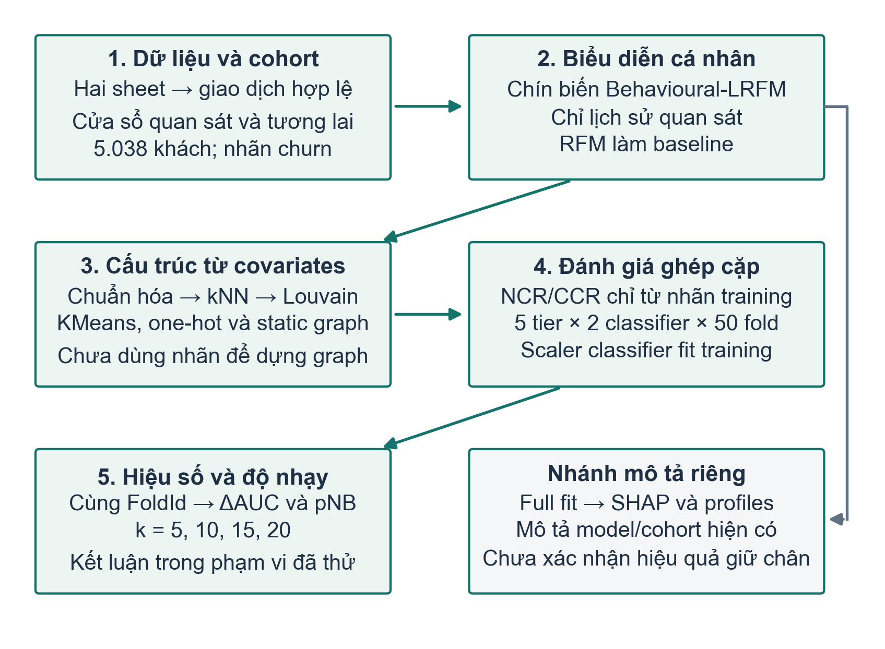
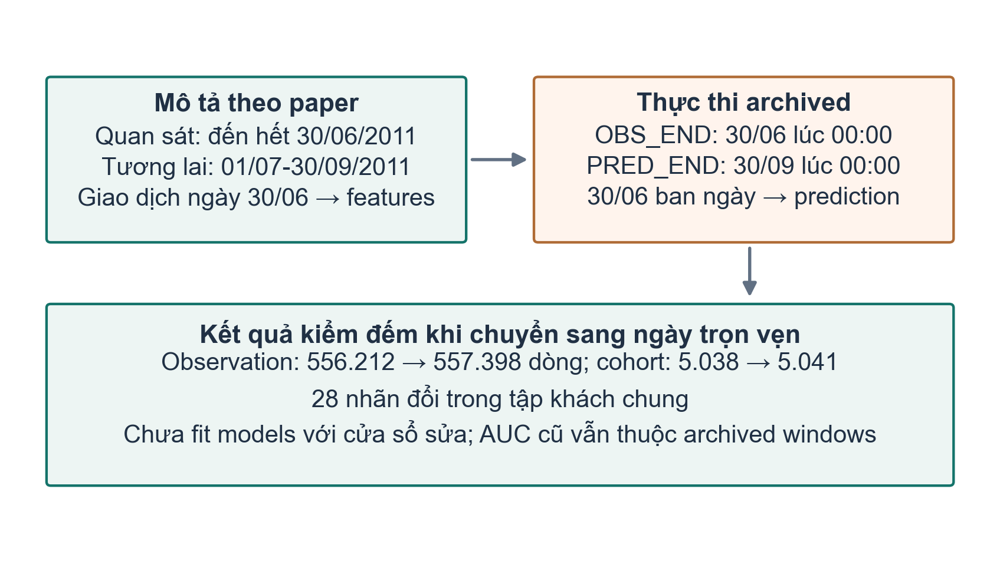
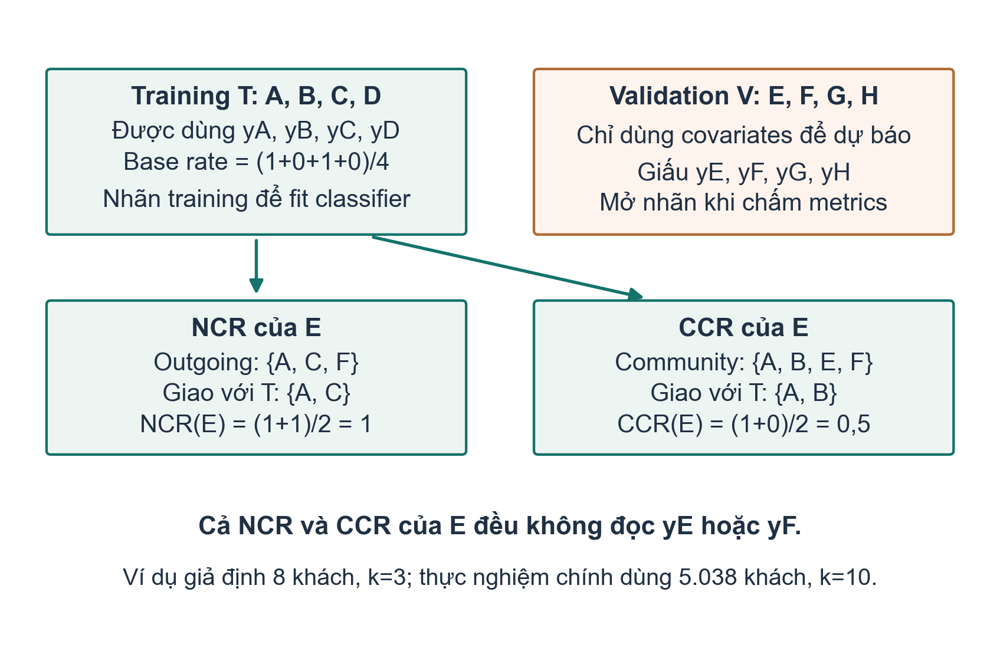
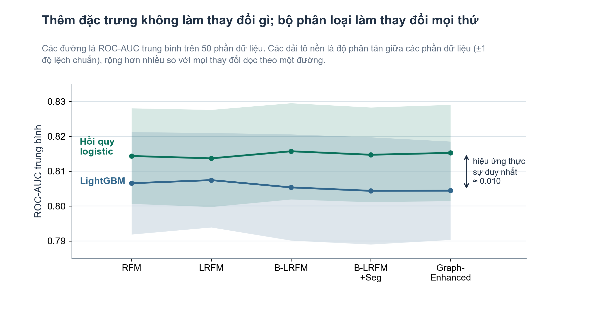

# Quy trình nghiên cứu: từ dữ liệu giao dịch đến kết quả âm về đặc trưng đồ thị

**Tài liệu làm việc của nhóm · Paper #366956 · Bản mở rộng và sửa bố cục 13/10/2026**

Tên paper: *When Graph-Derived Neighbourhood Features Do Not Help: A Leakage-Controlled Evaluation of Behavioural-LRFM Churn Prediction in Non-Contractual Retail*. Tài liệu này diễn giải toàn bộ bản thảo `paper/main.tex` và PDF 12 trang, đối chiếu với mã nguồn, kiểm toán và đợt chạy lại ngày 12/10/2026. Đối tượng đọc đã biết Python và học máy cơ bản. Cấu trúc năm chương tham khảo hai ảnh mục lục do người dùng cung cấp; nội dung nghiên cứu được xác định bằng paper và bằng chứng thực thi.

Quy ước nguồn: **[P]** là bản thảo; **[C]** là mã nguồn; **[A]** là kiểm toán; **[R]** là chạy lại thực tế. **Đề xuất** chỉ một việc có thể làm tiếp, chưa phải kết quả đã có. Danh sách nguồn và đường dẫn nằm ở cuối tài liệu. Khi [P] và [C] khác nhau, tài liệu nêu cả hai thay vì âm thầm lựa chọn một phiên bản.

## Cách dùng tài liệu trong nhóm

Tài liệu này cần trả lời được hai tầng câu hỏi: vì sao nghiên cứu được thiết kế như vậy, và một thành viên phải làm gì để đi từ dữ liệu đến một kết luận kiểm chứng được. Chương 1 giải thích nền tảng và khoảng trống; Chương 2 biến câu hỏi thành phép so sánh; Chương 3 là hướng dẫn thao tác, gồm đầu vào, ví dụ, kiểm soát và đầu ra; Chương 4 đọc kết quả; Chương 5 chốt trạng thái và việc bàn giao. Các phụ lục giúp chạy lại, báo cáo với giảng viên và kiểm tra hiểu biết.

Nếu mới tham gia, đọc Lời mở đầu, mục 2.4, sơ đồ 3.1, ví dụ một fold ở 3.13 và bảng tiến độ 5.4 trước. Sau đó đi lần lượt từng bước Chương 3 cùng source Python. Không cần thuộc mọi thư viện để hiểu kết luận, nhưng phải biết cột nào được tạo trước CV, cột nào cần nhãn training và dòng kết quả nào hỗ trợ phát biểu mình định nói.

Ví dụ trong tài liệu là dữ liệu giả định để tính tay. Chúng không được ghép vào Online Retail II và không được báo cáo như một thực nghiệm mới. Các bảng AUC, p-value và counts thực có dẫn [P], [A] hoặc [R]. Phần công việc tiếp theo là đề xuất, không phải việc đã hoàn tất.

## Lời mở đầu

### 1. Paper nghiên cứu điều gì?

Một cửa hàng trực tuyến thường không biết khách hàng đã rời đi hay chỉ đang chờ lần mua tiếp theo. Khác với dịch vụ thuê bao, khách không phải bấm hủy hợp đồng. Vì vậy nghiên cứu phải quy ước: nếu một khách đã từng mua nhưng không mua trong một cửa sổ tương lai, khách được gán nhãn rời bỏ, gọi là churn. Sau đó mô hình học từ lịch sử trước cửa sổ ấy để xếp hạng nguy cơ không mua trở lại. Nhãn phản ánh sự bất hoạt trong thời gian đã chọn; nó không chứng minh khách vĩnh viễn rời cửa hàng.

Paper đặt câu hỏi cụ thể: **các khách có hành vi mua tương tự có cung cấp thêm thông tin giúp dự báo churn của nhau hay không?** RFM mô tả mỗi người bằng lần mua gần nhất, tần suất và tổng chi tiêu. Pipeline mở rộng lên chín đặc trưng hành vi, nối các khách gần nhau trong không gian đó thành đồ thị, tìm cộng đồng, rồi thêm đặc trưng của nút và tỷ lệ churn của hàng xóm/cộng đồng vào mô hình dự báo. Ý tưởng trực giác là một người có thể giống nhóm đang rời bỏ, dù riêng hồ sơ cá nhân chưa thể hiện hết rủi ro.

Kết quả chính lại là một kết quả âm (negative result): với Online Retail II, hai classifier và các cấu hình đã thử, thêm đặc trưng không tạo cải thiện có ý nghĩa thống kê so với RFM. Kết quả âm vẫn có giá trị vì nó cho biết một hướng xây dựng tưởng hợp lý chưa đem lại lợi ích được xác nhận trong điều kiện kiểm tra rõ ràng. Câu kết luận phù hợp là “chưa phát hiện cải thiện có ý nghĩa trong phạm vi này”, không phải “mọi đồ thị đều vô ích”. [P: Abstract, Introduction, Results, Discussion; A; R]

### 2. Lý do thực tiễn và lý thuyết

Về thực tiễn, cửa hàng có ngân sách giữ chân hữu hạn. Nếu mô hình đơn giản cho thứ hạng nguy cơ tương đương mô hình phức tạp, nhóm vận hành tránh được chi phí dựng đồ thị, bảo trì community và xử lý đặc trưng phụ thuộc nhãn. Ngược lại, nếu đồ thị đem lại cải thiện ổn định, cửa hàng có căn cứ để đầu tư. Nghiên cứu chưa có phản hồi chiến dịch marketing, vì vậy chưa tính được lợi nhuận thực từ việc gửi ưu đãi.

Về lý thuyết, có sự khác nhau giữa **giống nhau** và **tương tác với nhau**. Hai khách có tần suất và chi tiêu gần nhau được nối trong similarity graph, nhưng họ có thể chưa từng liên hệ. Trong đồ thị viễn thông, cạnh có thể là cuộc gọi thực giữa hai thuê bao; đó là nguồn thông tin ngoài hồ sơ cá nhân. Một graph dựng lại từ chính chín đầu vào của classifier có thể chỉ làm trơn thông tin đã có. Đây là lời giải thích được paper thảo luận, chưa phải cơ chế đã được chứng minh bằng thí nghiệm nhân quả.

### 3. Mục tiêu, câu hỏi, đối tượng và phạm vi

Mục tiêu tổng quát là kiểm tra phần giá trị dự báo tăng thêm khi bổ sung các lớp biểu diễn hành vi và đồ thị vào RFM, với kiểm soát nhãn đánh giá và sự biến thiên do chia fold. Mục tiêu cụ thể gồm: xây dựng cohort khách hàng; tạo nhãn theo thời gian; dựng năm tier đặc trưng; đánh giá hai classifier trên cùng partitions; kiểm tra độ nhạy theo số hàng xóm; đối chiếu SHAP với so sánh hiệu năng; và lưu bằng chứng để người khác có thể chạy lại.

Các câu hỏi là: thêm L/hành vi, segment/community và graph block có giúp hơn RFM không; kết luận đổi theo partition/k không; SHAP cao có đồng nghĩa tăng chất lượng dự báo không? Đây là cách tổ chức lại paper để thảo luận, không phải giả thuyết đăng ký trước.

Đối tượng phân tích là khách đã có giao dịch hợp lệ trong cửa sổ quan sát tại một nhà bán lẻ trực tuyến của Anh. Đơn vị dữ liệu gốc là dòng hàng trong hóa đơn; đơn vị đưa vào classifier là khách hàng. Phạm vi kết luận gồm một dataset, một quy ước churn theo cửa sổ tương lai, một họ graph kNN trên Behavioural-LRFM, hai classifier trong repeated CV và bốn mức graph degree. Không mở rộng trực tiếp thành kết luận cho thị trường Việt Nam, khách thuê bao hay mọi retailer.

### 4. Phương pháp và đóng góp

Đây là nghiên cứu định lượng thực nghiệm trên dữ liệu giao dịch thứ cấp. Nó dùng feature engineering, clustering/community detection, supervised classification, repeated cross-validation và kiểm định hiệu số ghép cặp. Không tuyển người trả lời, không dùng bảng hỏi, thang Likert, EFA, CFA hay SEM. “Chọn mẫu” trong ngữ cảnh này là xác định cohort bằng quy tắc làm sạch và thời gian, không phải lấy mẫu người tham gia khảo sát.

Đóng góp tăng dần nằm ở giao thức đánh giá và sự minh bạch của kết quả âm. RFM, kNN, Louvain, Leiden, LightGBM, logistic regression và SHAP đều là công cụ đã có. Tỷ lệ churn hàng xóm cũng đã xuất hiện trong các ngữ cảnh khác. Paper nối các công cụ đó trong bài toán retail similarity graph và kiểm tra bằng nhãn fold-local cùng repeated CV. Không có bằng chứng đủ để gọi đây là thuật toán đồ thị mới, nghiên cứu đầu tiên tuyệt đối hay một cải thiện dự báo đã được xác nhận. Literature search của paper là có mục tiêu, không phải systematic review. [P: Related Work, Threats to Validity]

### 5. Tình trạng thực tế tại ngày 13/10/2026

Nhóm đã có dữ liệu raw, source Python, paper TeX/PDF, bảng kết quả theo fold, summary kiểm định, SHAP, hồ sơ cộng đồng, log và notebook tái lập. Audit ngày 12/10 ban đầu kiểm lại dữ liệu và phép tính trên artifact; sau đó một đợt riêng đã fit lại 10 công việc từ raw bằng môi trường ghim. Vì vậy ghi chú cũ “chưa full model rerun” đã được cập nhật bởi [R], còn phát hiện lệch mô tả phương pháp vẫn còn nguyên.

Mười công việc đều exit 0 trên Windows CPU, tổng thời gian khoảng **17 phút 42 giây**. Lượt repeated CV đầu dùng đặc trưng trong RAM lệch nhẹ một số số; lượt k10 đọc cache vừa tạo mới khớp byte fold scores và summary main archived. Không gọi tất cả đường chạy là giống tuyệt đối. Paper #366956 đã được xác minh Accepted trong hồ sơ kiểm tra; trạng thái này không tự chứng minh đã đăng ký, trả phí, hoàn thành camera-ready hoặc thống nhất người trình bày.

Việc tiếp theo có cơ sở nhất là thống nhất mô tả cửa sổ/L/NCR với code, thu hẹp claim SHAP và “only significant”, làm rõ transductive preprocessing và provenance baseline. Nếu sửa cửa sổ hoặc muốn kết luận riêng về NCR, phải tạo nhánh thí nghiệm mới và fit lại. Chưa fit mô hình với cửa sổ ngày đã sửa; notebook Colab đã được kiểm cấu trúc và helper nhưng chưa chạy toàn bộ trên Colab. [A; R]

### 6. Trả lời ngắn cho năm câu hỏi của nhóm

| Câu hỏi | Trả lời theo paper và hồ sơ hiện có |
|---|---|
| Nghiên cứu chủ đề gì? | Dự báo khách bán lẻ không có hợp đồng sẽ bất hoạt trong cửa sổ tương lai; kiểm tra giá trị tăng thêm của đặc trưng hành vi và đồ thị tương đồng. |
| Bài toán cần giải quyết? | Từ lịch sử giao dịch của khách đã mua, tạo điểm nguy cơ churn; đồng thời xác định phần tăng AUC rất nhỏ có bền qua các cách chia dữ liệu hay không. |
| Mục tiêu và điểm mới? | Đánh giá năm tier và hai classifier với nhãn aggregate theo fold, 10×5 CV ghép cặp và k-sweep; đóng góp là bằng chứng kết quả âm có kiểm soát, không phải phát minh LightGBM/Louvain hoặc chứng minh thắng baseline. |
| Phương pháp nghiên cứu? | Thực nghiệm định lượng trên log giao dịch thứ cấp: xây cohort/features/graph, phân loại có giám sát, repeated CV và corrected test; SHAP/profiles là nhánh mô tả. |
| Đến giai đoạn nào? | Có paper accepted, code, outputs archived và rerun thật 10 jobs; đang ở giai đoạn làm rõ phương pháp và chuẩn bị sửa bản thảo. Chưa fit cửa sổ sửa, chưa ablation riêng NCR/CCR, chưa external/campaign validation, chưa thực chạy notebook trên Colab. |

Một câu trình bày dễ nhớ là: “Chúng em thử xem thêm quan hệ tương đồng giữa khách có giúp dự báo rời bỏ hơn ba biến RFM không; sau khi đánh giá trên nhiều cách chia và kiểm soát nhãn, chưa thấy cải thiện có ý nghĩa trong tập dữ liệu này.” Câu này đủ nêu chủ đề, phép thử và kết quả mà không biến kết quả âm thành khẳng định mọi graph đều vô dụng.

## Chương 1. Cơ sở lý thuyết, nghiên cứu liên quan và khoảng trống

### 1.1. RFM, LRFM và hành vi mua

RFM là cách nén lịch sử giao dịch thành ba số. Recency $R$ đo số ngày từ lần mua gần nhất tới mốc phân tích. Frequency $F$ đếm số hóa đơn khác nhau; một hóa đơn có mười dòng sản phẩm vẫn là một lần mua. Monetary $M$ cộng giá trị dòng hàng hợp lệ. Người có $R$ lớn đã lâu không mua; người có $F$ lớn mua nhiều lần; người có $M$ lớn tạo nhiều doanh thu trong cửa sổ. Những ý nghĩa này giúp đọc dữ liệu, nhưng dấu tác động thực tế vẫn phải được mô hình và dữ liệu kiểm tra.

LRFM thêm $L$. Cần chú ý hai định nghĩa đang tồn tại: paper viết khoảng ngày từ lần mua đầu tới lần mua cuối; code tính từ lần mua đầu tới ngày phân tích. Một khách lần đầu mua cách mốc 400 ngày, lần cuối cách mốc 150 ngày sẽ có $L$ trong code khoảng 400, còn định nghĩa first-to-last khoảng 250. Chênh lệch gắn với recency, nên không coi đây là thay đổi tên gọi vô hại. Tài liệu quy trình dùng định nghĩa thực thi để giải thích kết quả hiện có.

Behavioural-LRFM bổ sung giá trị trung bình đơn hàng, kích thước giỏ, độ đa dạng sản phẩm, tỷ lệ hủy và khoảng cách giữa hai lần mua. Mục đích là mô tả cách mua ngoài ba tổng lượng RFM. Tuy vậy nhiều biến có quan hệ với nhau: AOV được tính từ $M/F$; độ đa dạng có thể tăng theo số lần mua. Có nhiều cột hơn không đảm bảo có nhiều thông tin độc lập hơn.

### 1.2. Phân đoạn và dự báo là hai nhiệm vụ khác nhau

Phân đoạn khách hàng (segmentation) tìm nhóm có đặc điểm tương đồng khi chưa cần nhãn churn. Dự báo churn dùng nhãn để học xác suất hoặc điểm nguy cơ cho khách chưa biết kết quả. Một partition có modularity cao có thể hữu ích để mô tả cộng đồng nhưng không tăng ROC-AUC. Ngược lại, classifier dự báo tốt không tự tạo các segment dễ dùng cho chiến dịch. Quy trình phải xác định đang đánh giá nhiệm vụ nào trước khi chọn metric.

Nghiên cứu Corrêa Vianna Filho và cộng sự là điểm xuất phát về segmentation từ góc nhìn graph và maximum k-cut. Paper hiện tại chuyển phạm vi sang supervised churn trên không gian hành vi liên tục. Vì thế không tính phần trăm “cải thiện clustering” bằng silhouette ở hai không gian khác nhau. Silhouette đo sự gắn kết/tách biệt theo khoảng cách của chính không gian được dùng; đổi từ điểm RFM rời rạc ba chiều sang chín biến liên tục đã đổi đối tượng đo. [P: Related Work; Results 8.5]

### 1.3. Đồ thị tương đồng và cộng đồng

Mỗi khách là một nút. Sau chuẩn hóa chín biến, khoảng cách Euclidean xác định khách nào gần nhau. Danh sách $k$ hàng xóm của A có thể chứa B, trong khi danh sách của B không chứa A. Danh sách này có hướng theo cách chọn. Graph NetworkX sau đó nhận cạnh nếu một trong hai phía chọn nhau, tạo graph union vô hướng. Do vậy “k10” không có nghĩa mọi nút trong graph cuối có degree đúng 10.

Louvain tìm partition có modularity cao theo trọng số cạnh. Leiden cải tiến việc tạo cộng đồng kết nối tốt. Hai thuật toán cho phép mô tả cấu trúc mà không dùng churn labels. Trong thực nghiệm chính, Louvain được dùng để tạo dummies và community churn rate. Leiden đã được tính partition nhưng chưa có một so sánh prediction repeated CV với các kiểm soát tương đương. Không biến việc “đã chạy Leiden” thành bằng chứng “kết luận dự báo bền với mọi detector”.

### 1.4. Target leakage và thông tin được phép dùng

Rò rỉ nhãn (target leakage) xảy ra khi thông tin về kết quả cần dự báo đi vào đầu vào đánh giá. Với NCR, vấn đề dễ thấy: nếu tính tỷ lệ churn từ toàn bộ nhãn trước khi chia fold, nhãn của khách validation sẽ ảnh hưởng đặc trưng của các khách hàng xóm. CCR toàn bộ cộng đồng cũng có vấn đề tương tự. Điểm validation khi ấy không còn đại diện cho dự báo với nhãn chưa biết.

Kiểm soát hiện có chỉ dùng nhãn training để tính NCR/CCR cho cả training và validation của fold ấy. Điều này bảo vệ khỏi validation labels trong hai aggregate. Tuy nhiên preprocessing của graph dùng covariates toàn bộ cohort; đó là đánh giá chuyển dẫn (transductive). Classifier scaler lại fit trong fold. Hai mức cần được mô tả riêng. Không thấy validation labels vào CV aggregates không đồng nghĩa toàn bộ pipeline đã là đánh giá quy nạp (inductive) cho khách hoàn toàn mới.

### 1.5. Ba mạch nghiên cứu liên quan

Mạch biểu diễn khách hàng gồm nghiên cứu RFM retail của Chen và cộng sự, extended RFM của Ho và cộng sự, cùng RFM biến thiên theo thời gian của Mena và cộng sự. Chúng giải thích vì sao cần cân nhắc thêm chiều quan hệ, hành vi hoặc thời gian. Tài liệu này dùng chúng theo vai trò được paper nêu, không khẳng định đã đọc toàn văn từng nghiên cứu hay kiểm lại mọi kết quả của chúng.

Mạch cấu trúc gồm graph segmentation, modularity, Louvain, Leiden và dự báo churn trên mạng tương tác. Kostić và cộng sự dùng mạng viễn thông; Lee và Woo dùng dynamic social graph. Chúng cung cấp đối chiếu về **ý nghĩa cạnh**, không phải baseline cùng dataset để so số AUC trực tiếp. Mạch đánh giá gồm Dietterich, Nadeau–Bengio, Bouckaert–Frank và Demšar, làm rõ vì sao điểm của các fold dùng training data chồng lấn không phải quan sát độc lập.

LightGBM, XGBoost và SHAP là công cụ thực nghiệm/giải thích. Trong repeated CV chính chỉ LightGBM và logistic regression được dùng; Decision Tree, Random Forest và XGBoost xuất hiện trong pipeline single-seed rộng hơn. Nêu đúng vai trò giúp nhóm tránh kể tất cả model như đã được kiểm định theo cùng giao thức.

### 1.6. Khoảng trống được kiểm tra

Khoảng trống thực hành mà paper trực tiếp xử lý là đánh giá một lợi ích rất nhỏ bằng một partition rồi xem đó là tiến bộ của feature engineering. Pipeline single-seed từng cho graph tăng khoảng 0,0033 AUC. Câu hỏi là chênh đó còn tồn tại khi nhãn aggregate được kiểm soát và partition được lặp hay không. Đây là khoảng trống có phép thử thực nghiệm cụ thể.

Khoảng trống mở tiếp theo là graph retail có nguồn tín hiệu ngoài bảng hành vi, như tương tác giới thiệu hoặc quan hệ hộ gia đình, và cách đánh giá triển khai theo thời gian. Paper chưa chứng minh các graph ấy tốt hơn. Phần “nghiên cứu trong nước” của ảnh mục lục không được lấp bằng tên bài giả; bibliography hiện có không cung cấp một tổng quan nội địa có hệ thống. Nếu nhóm cần chương literature Việt Nam, phải tìm và kiểm chứng nguồn riêng, ghi rõ tiêu chí tìm kiếm.

**Điểm kiểm tra cuối chương:** người đọc phân biệt được segmentation với prediction; similarity edge với interaction edge; label leakage với transductive covariates; và đóng góp giao thức với thuật toán mới. Câu thảo luận: nếu graph được dựng từ chính đầu vào classifier, nó có thể đưa vào loại thông tin mới nào, và thí nghiệm nào đủ để kiểm câu trả lời?

## Chương 2. Mô hình khái niệm và giả thuyết có thể kiểm tra

### 2.1. Mô hình khái niệm

Luồng lập luận gồm lịch sử mua trước mốc phân tích → biểu diễn cá nhân → nhóm tương đồng → đặc trưng đồ thị → dự báo bất hoạt tương lai. Biến đầu ra là nhãn churn, biến đầu vào là các cột của từng tier. Louvain/KMeans tạo categorical identifiers, không phải biến tiềm ẩn tâm lý. “Cộng đồng” ở đây là partition thuật toán, không tự chứng minh có một cộng đồng xã hội hay quan hệ ảnh hưởng.

Nếu khách tương tự có kết quả tương tự, tỷ lệ churn training lân cận có thể giúp dự báo. Nhưng RFM có thể đã biểu diễn thông tin đó. Cần kiểm trên validation, không chỉ correlation hoặc SHAP.

### 2.2. Tái dựng giả thuyết vận hành

Bảng dưới là **tái dựng vận hành cho tài liệu học nhóm**, không phải giả thuyết đăng ký trước hay hệ phương trình SEM của paper. Với một classifier cố định, định nghĩa $d_f$ là AUC cấu hình mở rộng trừ AUC baseline ở cùng fold. Giá trị trung bình dương có thể gợi lợi ích; cần kiểm định và xem độ lớn hiệu ứng trước khi kết luận.

| Câu hỏi | Đối chiếu thực nghiệm | Bằng chứng cần đọc | Trạng thái |
|---|---|---|---|
| Thêm L có lợi? | LRFM − RFM | Summary paired folds | Đã kiểm tra |
| Thêm hành vi có lợi? | B-LRFM − RFM | AUC và PR-AUC | Đã kiểm tra |
| Thêm chỉ báo nhóm có lợi? | Seg so với tier trước | Hiệu số cùng folds | Có dữ liệu để phân tích |
| Graph block có lợi? | Graph so với RFM/Seg | Main và k-sweep | Đã kiểm ở mức block |
| Riêng NCR có lợi? | Full so với full bỏ NCR | Repeated ablation riêng | Chưa làm |

Các tier-vs-RFM đã được summary script kiểm định trực tiếp. So với tier liền trước cũng có thể tính từ cùng fold scores, nhưng cần ghi đó là phân tích bổ sung và giữ phạm vi phép thử. Graph so với Seg thay đổi sáu biến cùng lúc: bốn static graph features, NCR và CCR. Vì vậy nó không cô lập NCR hoặc CCR.

### 2.3. Tiêu chí đánh giá giả thuyết

Nếu chênh AUC nhỏ, đổi dấu giữa các lần chia hoặc không đạt kiểm định đã chọn, nhóm báo cáo chưa phát hiện cải thiện. $p$ lớn không phải xác suất giả thuyết null đúng và cũng không chứng minh effect bằng 0. Muốn kết luận tương đương cần biên hiệu ứng có ý nghĩa thực tiễn và equivalence test được xác định phù hợp; thực nghiệm hiện chưa có điều đó.

Tương tự, SHAP rank cao không phải tiêu chí chấp nhận giả thuyết lợi ích tăng thêm. SHAP trả lời một fitted model đã dùng các biến như thế nào. Ablation có kiểm soát trả lời bỏ biến thì chất lượng ngoài mẫu đổi bao nhiêu. Kết quả giữa hai câu hỏi có thể khác mà không mâu thuẫn.

**Điểm kiểm tra cuối chương:** mỗi câu hỏi phải gắn được với một cặp cấu hình, một metric, cùng fold IDs và một phạm vi kết luận. Câu thảo luận: nếu đổi cả classifier lẫn feature set và AUC tăng, nhóm cần thêm cặp so nào để biết phần tăng đến từ đâu?

### 2.4. Thiết kế thực nghiệm: đổi gì, giữ gì và đo gì?

Một thí nghiệm feature engineering có thể bị hiểu sai nếu cùng lúc thay dữ liệu, classifier, tham số và cách chia fold. Vì vậy trước khi chạy cần viết một “hợp đồng so sánh”: hai cấu hình được phép khác ở đâu, còn lại giữ cố định. Trong main protocol, dataset/cohort, nhãn, FoldId và tham số của mỗi classifier giữ nguyên khi so tier. Khi đổi classifier, coi đó là một câu hỏi riêng. K-sweep thay k và các cấu trúc sinh từ k, gồm graph, cộng đồng và số dummy; nó không cô lập duy nhất số cạnh.

| Thành phần thiết kế | Thiết lập hiện có | Vai trò kiểm soát |
|---|---|---|
| Đơn vị dự báo | Một khách đã mua trong observation | Không chia các dòng hóa đơn của cùng khách thành nhiều mẫu học độc lập |
| Nhãn cần dự báo | Không có purchase hợp lệ trong prediction → y=1 | Chốt định nghĩa trước khi đọc AUC |
| Baseline | RFM với từng classifier tương ứng | So giá trị tăng thêm với một cấu hình đơn giản |
| Biến thay đổi ở main | Năm tier: 3/4/9/32/38 cột tại k10 | Đo ảnh hưởng của biểu diễn ở mức tier/block |
| Biến thay đổi ở model comparison | Logistic regression và LightGBM | Đo khác biệt classifier khi feature tier được giữ hoặc nêu rõ khác nhau |
| Partition đánh giá | 10 seeds × 5 folds, dùng chung | Ghép cặp hiệu số trên cùng khách validation |
| Thông tin nhãn cho NCR/CCR | Chỉ y của training ở fold đang xét | Chặn validation-label leakage |
| Metrics chính | ROC-AUC và average precision | Đo xếp hạng; không suy thành hiệu quả chiến dịch |
| Phép suy luận | pNB hai phía, ngưỡng báo cáo 0,05 | Điều chỉnh phương sai do folds chồng lấn; chưa family-adjusted |

**Phân biệt ba phép so cụ thể.** LGBM/Graph trừ LGBM/RFM trả lời toàn bộ mở rộng features so với baseline dưới LightGBM. LGBM/Graph trừ LGBM/Seg trả lời thêm sáu graph columns có giúp hơn tier có segmentation không. LogReg/RFM trừ LGBM/Graph trả lời pipeline đơn giản và pipeline đầy đủ khác nhau bao nhiêu; do đổi cả model lẫn features, không tách được nguồn khác biệt. Viết câu hỏi trước sẽ ngăn việc lấy một p-value của phép so thứ ba để trả lời phép so thứ hai.

Main summary lấy bốn tier mở rộng so với RFM, hai models và hai metrics: 4×2×2=16 phép so. Có 50 paired differences cho mỗi phép so; không có 50 dataset độc lập. Việc tính thêm Graph−Seg từ CSV là phân tích bổ sung, cần ghi rõ nguồn và phạm vi. Việc muốn kết luận riêng NCR cần một thiết kế mới full-versus-without-NCR, cùng folds và protocol; dữ liệu tier hiện có chưa thay cho ablation đó.

### 2.5. Từ giả thuyết đến kết luận được phép viết

Giả thuyết vận hành là: tier mở rộng có mean score cao hơn baseline dưới các kiểm soát đã định. Phép kiểm định hai phía trong source kiểm tra hiệu số trung bình khác 0; vì vậy nếu significant còn phải xem dấu để biết tăng hay giảm. Nếu delta dương rất nhỏ nhưng p lớn, chỉ nói quan sát được một point estimate dương và chưa xác nhận gain. Nếu delta âm và p lớn, cũng không nói graph chắc chắn gây hại.

Đóng góp khoa học của một kết quả âm cần ba phần: phép thử đủ rõ để người khác lặp lại; bằng chứng đủ để thấy tại sao một kết luận ban đầu không bền; và giới hạn đủ để biết thí nghiệm tiếp theo nên thay điều gì. Ở đây phần mạnh là kiểm soát nhãn fold-local, pairing, repeated partitions và k-sweep. Phần còn thiếu là graph tín hiệu độc lập, nhiều retailer, prospective/temporal evaluation và business outcomes. Không cần biến một null finding thành chiến thắng của một thuật toán khác để bài có giá trị.

Khi đọc related work, ghi mỗi bài theo bốn trường: nguồn dữ liệu, ý nghĩa cạnh, định nghĩa churn, giao thức đánh giá. Hai paper cùng dùng “churn” nhưng một bên có sự kiện hủy thuê bao và một bên chỉ có inactivity không đặt ra cùng cơ chế. AUC của hai dataset không phải một bảng xếp hạng chung. Với literature trong nước, hồ sơ hiện tại chưa có tổng quan có hệ thống; để trống phạm vi hoặc ghi cần tìm thêm đáng tin hơn tự lấp một chương bằng nguồn chưa kiểm.

## Chương 3. Thiết kế nghiên cứu và quy trình thực hiện

### 3.1. Quy trình tổng thể theo thứ tự chạy

Bảng recipe ghi đầu vào, thao tác và đầu ra theo [P: Sections 3–7] và [C: `build_features`, graph construction, `fold_features`, evaluation loop].

| Giai đoạn | Đầu vào | Thao tác và tham số chính | Đầu ra |
|---|---|---|---|
| 1. Nhập dữ liệu | Hai worksheet XLSX | Đọc, ghép, chuẩn tên cột | Transaction log |
| 2. Làm sạch | Log và ID/date | Lọc mua hợp lệ, deduplicate | Purchase/cancellation tables |
| 3. Chia thời gian | InvoiceDate | Áp dụng timestamps hiện hữu | Observation/prediction |
| 4. Tổng hợp | Khách trong observation | Tính chín biến và nhãn | Cohort 5.038 khách |
| 5. Dựng graph | Chín biến chuẩn hóa | Euclidean kNN; $w=1/(1+d)$ | Graph + outgoing lists |
| 6. Phân nhóm | Graph và features | KMeans5, Louvain; Leiden mô tả | Dummies + communities |
| 7. Tạo matrix mỗi fold | Training IDs/labels | NCR/CCR training-only | Năm tier |
| 8. Fit và đánh giá | Tier + shared folds | Hai classifier; 10×5 folds | 500 score rows |
| 9. Kiểm định | Paired fold differences | Nadeau–Bengio; bootstrap mô tả | Summary và phạm vi kết luận |
| 10. Độ nhạy/mô tả | k5/10/15/20, full fit | Sweep; SHAP; profiles | Robustness + exploratory outputs |



Nhánh mô tả cuối cùng phải được đọc riêng với nhánh validation. Nó dùng full fit để diễn giải model và hồ sơ nhóm, không cung cấp một held-out evaluation mới.

### 3.2. Nhập và kiểm tra dữ liệu gốc

Online Retail II có hai worksheet, lần lượt 525.461 và 541.910 dòng, tổng 1.067.371. Số khoảng 541 nghìn thường nhắc tới chỉ một worksheet. Code đọc tất cả sheet rồi ghép; nhóm cần ghi số từng sheet để phát hiện trường hợp chỉ đọc mặc định sheet đầu. Trước khi fit, kiểm filename, dung lượng và hash của raw giúp biết đang dùng đúng dữ liệu, thay vì chỉ dựa vào tên “online_retail”.

Raw local đã được đối chiếu với bản tải trực tiếp từ UCI trong [R], cùng SHA256. Hash là dấu nhận diện file, không phải bằng chứng chất lượng mọi dòng. Nhóm vẫn phải kiểm kiểu ngày, customer ID, quantity, price và invoice. Dữ liệu thiếu CustomerID không thể tổng hợp thành hồ sơ khách trong pipeline này nên được bỏ. Việc bỏ ID thiếu làm giới hạn cohort; không suy ra mẫu đại diện cho toàn bộ khách retailer.

Đầu ra cần có một báo cáo tổng hợp counts và fingerprint, không đưa bản ghi cá nhân vào tài liệu trao đổi. Điểm kiểm tra là hai sheets đã được đọc, ngày parse thành datetime, số raw đúng và schema có các cột cần dùng. Nếu counts khác, dừng trước feature engineering và tìm nguyên nhân ở file/sheets/parse.

**Từ điển dữ liệu cần đọc trước khi groupby.** Tên trong bảng dưới là tên sau khi source bỏ khoảng trắng ở column names. Schema thật có `Invoice`, `Price`, `CustomerID`; không tự dùng tên `InvoiceNo`, `UnitPrice`, `CustomerID` từ một dataset gần giống mà chưa map. [C: `build_features`]

| Cột | Ý nghĩa và cách dùng | Lỗi cần tránh |
|---|---|---|
| Invoice | Mã hóa đơn; invoice bắt đầu bằng C được tách thành cancellation | Đếm dòng thành số lần mua hoặc bỏ duplicate chỉ theo invoice |
| StockCode | Mã loại hàng; dùng nunique cho basket/diversity | Đồng nhất số loại hàng với quantity |
| Description | Mô tả sản phẩm, không nằm trong chín đầu vào chính | Kể như đã có text embedding khi code không dùng |
| Quantity | Số lượng trên dòng; purchase yêu cầu >0 | Cộng dòng hủy/hoàn vào doanh thu mua dương |
| InvoiceDate | Thời điểm giao dịch có cả ngày và giờ | Hiểu timestamp 00:00 là hết ngày |
| Price | Đơn giá; purchase yêu cầu >0 | Dùng cột price làm M mà không nhân Quantity |
| CustomerID | Khóa khách để aggregate; dòng thiếu ID bị loại | Đưa ID số vào distance/classifier như một biến liên tục |
| Country | Thuộc tính có trong raw | Nói Country đã được encode trong thí nghiệm; paper ghi thành phần này chưa thực hiện |

**Điều kiện qua bước này:** chứng minh đang đọc đúng hai worksheet; có đủ cột cần thiết; raw hash khớp hoặc ghi rõ dataset version khác; datetime không thành chuỗi; feature table sau aggregate có đúng một row mỗi khách. Counts raw gồm cả dòng sẽ bị loại, vì vậy không kỳ vọng số dòng hợp lệ bằng tổng raw.

### 3.3. Làm sạch giao dịch và tách cancellation

Invoice bắt đầu bằng “C” được nhận diện là cancellation. Code giữ riêng cancellation records để tính tỷ lệ hủy, còn purchase table lấy dòng không hủy, Quantity > 0 và Price > 0. Sau đó bỏ duplicate rows và tính `TotalPrice = Quantity * Price`. Vì một hóa đơn có nhiều sản phẩm, không bỏ duplicate chỉ theo invoice ID. Dòng hàng hợp lệ mới được cộng vào $M$.

Cancellation không được cộng như doanh thu dương. Tỷ lệ hủy sử dụng số invoice hủy trong cửa sổ observation, không dùng cancellation phát sinh sau mốc phân tích. Đây là một kiểm soát đã có trong code v2, sửa vấn đề phiên bản cũ từng nhìn toàn bộ log. Điểm kiểm tra là mọi đặc trưng giao dịch dùng đúng cửa sổ đã chốt; việc lọc ngày phải áp dụng cả purchase lẫn cancellation.

**Ví dụ làm sạch giả định.** Ba dòng `Invoice=1001` có ba StockCode khác nhau vẫn thuộc một hóa đơn: cả ba dòng có thể cộng M, nhưng F chỉ tăng 1. Một dòng `Invoice=C1001` là cancellation, đi sang bảng riêng. Dòng không hủy nhưng Quantity=0 hoặc Price=0 không đi vào purchase table hiện tại. Hai dòng hoàn toàn giống nhau được `drop_duplicates()` loại một dòng; hai dòng cùng invoice nhưng khác StockCode không phải duplicate theo toàn row. Đó là lý do cần đọc chính điều kiện lọc thay vì chỉ viết “đã tiền xử lý dữ liệu”.

Sau khi sạch, kiểm hai nhánh riêng: purchase table tạo R/F/M/L/AOV/basket/diversity/IPT và xác định active trong prediction; cancellation table chỉ tạo cancellation rate trong observation. Nếu future cancellation đi vào rate quan sát, feature đang biết một sự kiện sau thời điểm dự báo. Mọi thay đổi quy tắc lọc phải có counts trước/sau và output version mới, vì nó có thể đổi cả features lẫn nhãn.

### 3.4. Cửa sổ thời gian và cohort

Paper mô tả observation 01/12/2009–30/06/2011 và prediction 01/07/2011–30/09/2011. Code hiện đặt `OBS_END = Timestamp("2011-06-30")`, `PRED_END = Timestamp("2011-09-30")`; timestamp không có giờ là 00:00. Purchase observation thỏa `date <= OBS_END`; prediction thỏa `date > OBS_END` và `date <= PRED_END`. Vì vậy giao dịch ban ngày 30/6 được đưa vào prediction, giao dịch ban ngày 30/9 bị loại khỏi prediction. [C; A]

Cách cắt này tạo 556.212 observation rows và 5.038 khách. Nếu thay bằng ngày trọn vẹn, audit tính được 557.398 observation rows, 5.041 khách; 28 labels đổi trong phần khách chung. Đây mới là kiểm đếm, không có bộ model đã fit cho cửa sổ sửa. Không ghép counts mới vào bảng AUC cũ rồi gọi đó là một thực nghiệm hoàn chỉnh.

Khi tái lập archived result, giữ nguyên timestamps và ghi rõ. Khi làm một phiên bản sửa, có thể dùng half-open windows như minh họa dưới; **đây là đề xuất, chưa phải source hiện tại**. Q3 trọn vẹn có 92 ngày, vì vậy không gọi chính xác nó là 90 ngày.

```python
# Proposed whole-day windows; not the current archived implementation.
obs = purchases[(purchases.InvoiceDate >= "2009-12-01") &
                (purchases.InvoiceDate < "2011-07-01")]
pred = purchases[(purchases.InvoiceDate >= "2011-07-01") &
                 (purchases.InvoiceDate < "2011-10-01")]
```

Cohort chỉ gồm người đã có mua hợp lệ trong observation. Customer mới chỉ xuất hiện trong prediction không được đưa vào đánh giá này. Nhãn $y_i=1$ nếu khách cohort không có purchase hợp lệ trong prediction; $y_i=0$ nếu có. Với implementation hiện có, 3.285/5.038 khách là churn, khoảng 65,2044%. Churn là lớp đa số, không phải positive hiếm.



**Ba tình huống cần phân biệt.** Khách A mua trước mốc và có một purchase hợp lệ trong prediction → label 0. Khách B mua trước mốc nhưng prediction chỉ có cancellation → vẫn label 1 trong implementation này, vì active set được lấy từ purchase table. Khách C chỉ bắt đầu mua trong prediction → ngoài cohort, không được thêm như một non-churner để làm đẹp tỷ lệ. Cả ba là ví dụ quy tắc, không phải bản ghi cụ thể từ raw.

**Vì sao chia theo thời gian vẫn chưa là temporal model validation?** Observation/prediction định nghĩa thời điểm features và nhãn cho từng khách. Sau đó main CV chia ngẫu nhiên các khách trong cùng cohort bằng StratifiedKFold; nó không train ở một quý cũ và test ở một quý triển khai mới. Hai thao tác có chức năng khác nhau. Một thí nghiệm prospective cần tạo nhiều mốc observation mới theo thời gian, chốt thông tin được biết ở mỗi mốc, rồi đánh giá ở giai đoạn sau; đó là hướng đề xuất, chưa có trong result tables.

### 3.5. Tạo chín đặc trưng

Đặt $a$ là ngày phân tích, $t_i^{first}$/$t_i^{last}$ là ngày mua đầu/cuối observation, $q_{ir}$ là số lượng và $p_{ir}$ là đơn giá dòng hàng. Các công thức dưới diễn giải code [C], không phải hệ phương trình được paper đánh số. Phép lấy `.dt.days` trong code trả số ngày nguyên; nhóm cần nhớ dữ liệu có giờ.

$$
R_i = a-t_i^{last},\qquad L_i = a-t_i^{first}
$$

$F_i$ đếm invoice khác nhau. $M_i=\sum_r q_{ir}p_{ir}$ trên purchase observation, và $AOV_i=M_i/F_i$. BasketSize là trung bình số StockCode khác nhau trong mỗi invoice; không phải tổng quantity trong giỏ. ProductDiversity là số StockCode khác nhau trên toàn observation của khách. Hai biến basket/diversity không thể dùng thay nhau.

CancellationRate là số invoice hủy chia cho số invoice hủy cộng $F_i$; khách không có hủy nhận 0. InterpurchaseTime lấy ngày đầu ghi cho mỗi invoice, sắp xếp theo thời gian, lấy trung bình các khoảng giữa invoice liên tiếp. Khách chỉ có một invoice chưa có interval nên nhận median IPT của cohort. Imputation này hiện được tính trước CV từ toàn bộ covariates; nếu muốn inductive protocol phải fit median trong training và áp dụng cho validation.

Ví dụ giả định cho học: một khách có ba invoice, tổng 300 đơn vị tiền, mỗi giỏ lần lượt có 2, 4, 3 loại hàng, toàn lịch sử có 6 loại khác nhau. Khi ấy F=3, M=300, AOV=100, BasketSize=3, ProductDiversity=6. Nếu có một invoice hủy trong observation, cancellation rate bằng 1/(1+3)=0,25. Đây là ví dụ minh họa, không phải một customer record trong dataset.

Đầu ra là một dòng mỗi CustomerID với chín feature và một label. Kiểm tra F dương, M dương với cohort purchase, cancellation rate trong [0,1], không duplicate IDs, không NaN chưa xử lý. Giữ riêng label khỏi danh sách chín cột dùng dựng graph. Chỉ cần vô tình đưa `Churn` vào distance là đổi bài toán và làm hỏng kiểm soát.

**Từ điển feature thực thi.** Công thức L dưới đây theo code, cùng sự khác biệt với paper đã nêu. Các phép ngày trả phần nguyên bằng `.dt.days` hoặc ép chênh lệch sang ngày, không phải một phép đo continuous time tùy ý. [C: lines tạo `recency` đến `ipt` trong `build_features`]

| Feature | Quy tắc tạo trong archived implementation | Đơn vị / kiểm tra |
|---|---|---|
| L | Ngày phân tích trừ lần mua đầu observation | Ngày nguyên; khác first-to-last của paper |
| R | Ngày phân tích trừ lần mua cuối observation | Ngày nguyên; thường R≤L cho khách cùng cửa sổ |
| F | Số Invoice khác nhau trong purchases observation | Số hóa đơn, tối thiểu 1 trong cohort |
| M | Tổng Quantity×Price của các dòng purchase observation | Tiền theo đơn giá raw, không phải số sản phẩm |
| AOV | M/F | Tiền mỗi hóa đơn; có quan hệ đại số với RFM |
| BasketSize | Trung bình số StockCode khác nhau mỗi Invoice | Số loại hàng trung bình mỗi giỏ |
| ProductDiversity | Số StockCode khác nhau toàn lịch sử observation của khách | Số loại hàng khác nhau |
| CancellationRate | Số invoice C / (số invoice C + F), thiếu → 0 | Tỷ lệ trong [0,1], chỉ observation |
| InterpurchaseTime | Trung bình khoảng ngày giữa các Invoice liên tiếp; khách một invoice → median cohort | Ngày; imputation hiện dùng covariates toàn cohort |

**Tính tay một khách giả định.** Chọn analysis date 01/07/2011 lúc 00:00. Khách Z có ba hóa đơn purchase vào 01/01, 01/02 và 01/06/2011, đều lúc 00:00; tổng tiền từng hóa đơn là 60, 90, 150. Giỏ thứ nhất chứa X/Y; giỏ thứ hai Y/Z/U/V; giỏ thứ ba X/V/W. Có một invoice hủy vào 15/05. Khi đó tổng loại hàng là sáu mã X/Y/Z/U/V/W; ba giỏ có 2/4/3 loại. Tất cả là dữ liệu minh họa.

| Biến | Phép tính tay | Giá trị |
|---|---|---:|
| L theo code | 01/07 − 01/01 | 181 ngày |
| R | 01/07 − 01/06 | 30 ngày |
| F | Ba hóa đơn purchase | 3 |
| M | 60+90+150 | 300 |
| AOV | 300/3 | 100 |
| BasketSize | (2+4+3)/3 | 3 |
| ProductDiversity | Có sáu StockCode khác nhau | 6 |
| CancellationRate | 1/(1+3) | 0,25 |
| InterpurchaseTime | (31+120)/2 | 75,5 ngày |

Nếu dùng L như paper mô tả first-to-last, ví dụ này cho 151 ngày; L thực thi =151+30=181 do khoảng ngày được chọn ở 00:00. Với timestamps có giờ và phép lấy phần nguyên, không tự áp dụng mọi đẳng thức ngày như một phép toán continuous time. Nếu khách Z có thêm purchase hợp lệ ngày 15/08, label là 0 nhưng chín feature quan sát giữ nguyên; nếu không có, label là 1. Không đưa đơn tháng 8 vào M/F để dự báo chính nhãn từ tháng 8.

**Đầu ra bàn giao:** feature table kèm CustomerID mapping, danh sách chính xác chín cột, rule xử lý thiếu, định nghĩa cửa sổ và counts nhãn. Cache CSV giúp chạy nhanh nhưng không thay raw: phải chứng minh cache được tạo từ đúng raw/commit/windows. Source hiện đọc cache nếu thấy file tồn tại; tên `feat_cache.csv` tự nó không chứa fingerprint. Người tiếp nhận cần dùng output folder mới khi muốn thực sự build từ raw.

### 3.6. Chuẩn hóa, kNN và graph weights

StandardScaler đưa từng cột về thang chuẩn hóa trước khi đo Euclidean distance. Nếu không làm, monetary có thể lấn át cột nhỏ do khác đơn vị. Code hiện fit graph scaler trên toàn cohort; đây là thông tin covariates toàn bộ, cần giữ nhãn transductive trong mô tả. Không đồng nhất scaler này với scaler trong classifier pipeline.

NearestNeighbors lấy k+1 điểm để bỏ vị trí đầu thường là chính nút; artifact hiện tại không có self-neighbour. Với mỗi outgoing neighbour j, code thêm cạnh vào graph vô hướng nếu chưa có, trọng số như paper:

$$
w(i,j)=\frac{1}{1+d(i,j)}
$$

Đây là công thức graph trong [P: Section 5]. Hai điểm gần có cạnh nặng hơn. Ở k10, graph có 5.038 nút, 33.426 cạnh. Degree vô hướng thực tế 10–25, trung bình khoảng 13,27 theo audit, vì union nhận cả lựa chọn đi vào. NCR lại dùng đúng danh sách outgoing kNN, không dùng mọi graph neighbour vô hướng. Tài liệu công thức và code phải nói rõ tập nào.

**Ví dụ distance và weight.** Nếu hai vector sau standardization có Euclidean distance 0,5, cạnh có weight 1/1,5≈0,6667. Distance 2 cho weight 1/3≈0,3333. Cạnh gần nặng hơn, nhưng weight này không phải xác suất hai khách ảnh hưởng nhau. Một graph nối A với B vì B chọn A vẫn có cạnh vô hướng A–B; nếu B không thuộc outgoing list của A, B không đi vào NCR(A) của code. Degree và NCR vì vậy dùng hai tập quan hệ khác nhau.

**Lựa chọn thang đo đang làm gì?** Với mỗi feature j, StandardScaler tính trung bình và độ lệch chuẩn trên cohort covariates rồi biến đổi $z_{ij}=(x_{ij}-\mu_j)/\sigma_j$. Euclidean distance tính trong không gian z, không trên tiền và số ngày raw. Đây là lựa chọn biểu diễn, không phải chứng minh chín chiều có cùng giá trị kinh doanh. Dataset có M rất lớn ở một số khách có thể ảnh hưởng standardization; paper không báo một robustness study riêng cho robust scaling/log transform, nên không tự thêm các bước ấy khi tái lập số archived.

**Điểm kiểm tra graph:** số node bằng cohort; node IDs khớp vị trí dòng feature matrix; mọi outgoing list đủ k và không chứa chính nút ở artifact hiện có; graph không dùng cột Churn; weight dương; số cạnh/count communities được lưu cùng k. Nếu đổi thứ tự row nhưng giữ neighbor indices cũ, dù mọi file đều có 5.038 rows, labels sẽ bị gán cho sai node. CustomerID mapping là phần của hợp đồng dữ liệu, không phải chi tiết có thể bỏ.

### 3.7. Clustering, communities và static graph features

KMeans dùng 5 clusters, random_state=42, n_init=10 trong pipeline dự báo. Louvain dùng graph weights và seed=42. Partition k10 archived có 20 cộng đồng, modularity 0,8385; Leiden trong pipeline full có 20, modularity 0,8323. Modularity cao mô tả graph được xây, không chứng minh prediction tốt hoặc có contagion thật. KNN vốn tạo nhiều quan hệ cục bộ nên cấu trúc graph góp phần vào giá trị đó.

Bốn static graph features là Degree, WeightedDeg, PageRank và ClustCoeff. Degree đếm số cạnh; WeightedDeg cộng trọng số; PageRank đo vị trí kết nối theo thuật toán; ClustCoeff mô tả mức các hàng xóm nối với nhau theo cách tính weighted clustering của code. Các biến này không cần churn labels.

Segment IDs được one-hot để model không đọc community 19 như “lớn hơn” community 2. Với drop_first, KMeans5 tạo 4 dummies, Louvain20 tạo 19, tổng 23. Số dummies thay đổi khi k làm số cộng đồng thay đổi; con số 38 features chỉ là full matrix tại k10. Repeated CV chính không thêm Leiden dummies.

**Đọc các static features theo thao tác.** Degree là số cạnh của node trên union graph. WeightedDeg cộng weight các cạnh ấy; ba weight 2/3, 1/2 và 1/3 cho weighted degree 1,5, còn degree là 3. PageRank được tính bởi `nx.pagerank` có weights; ClustCoeff bởi `nx.clustering` có weights. Hai đại lượng sau cần cấu trúc graph đầy đủ để tính; không thể suy ra chúng chỉ từ ba số L/R/M của một khách. Source dùng toàn cohort covariates để dựng graph, nên static features cũng mang scope transductive đó.

Louvain community ID chỉ là mã partition. Khi rerun một thuật toán, community 2 có thể đổi tên mà không đổi tập node; so mã nguyên từng row chưa đủ để kết luận partition khác. Khi so detector hoặc environment, cần so thành viên/partition và đầu ra prediction, ngoài số communities/modularity. K10 có 20 cộng đồng không chứng minh có đúng 20 nhóm tự nhiên hoặc xã hội ngoài đời.

### 3.8. Tạo NCR/CCR bên trong từng fold

Gọi $T$ là tập chỉ số dòng/node trong training, $N_i$ là outgoing kNN list và $C_i$ là tập khách thuộc Louvain community của i. Code dùng vị trí dòng từ 0 đến n−1, có mapping sang CustomerID; không dùng trực tiếp mã CustomerID làm index của graph. Định nghĩa trung bình trên phần giao với training:

$$
NCR_i(T)=\frac{\sum_{j\in N_i\cap T} y_j}{|N_i\cap T|},\qquad CCR_i(T)=\frac{\sum_{j\in C_i\cap T} y_j}{|C_i\cap T|}
$$

Công thức này tái dựng `fold_features` [C] và làm rõ tập hàng xóm; paper diễn đạt công thức bằng lời ở Section 6. Khi mẫu số bằng 0, code dùng churn base rate của training fold. Validation labels không tham gia tổng. Với training row, CCR bao gồm label của chính row trong community mean; vấn đề target encoding train/validation lệch vẫn cần kiểm bằng leave-one-out hoặc inner cross-fitting. Đó là hướng cải tiến được audit chỉ ra, chưa có thí nghiệm riêng.

Ví dụ giả định: i có bốn outgoing neighbours, hai thuộc training với labels 1 và 0, hai thuộc validation. NCR dùng hai người training nên bằng 0,5; không nhìn hai labels validation. Ví dụ này minh họa quy tắc, dù cấu hình main dùng k10. Điểm kiểm tra là truyền đúng `train_idx`, không gọi hàm aggregate một lần ở ngoài CV rồi tái dùng trong mọi fold.

NCR/CCR trong source là mean labels không trọng số; weight 1/(1+d) dùng cho graph/community/static calculations, không được đưa vào phép average NCR. Nếu muốn thử weighted NCR, đó là feature variant mới và phải fit lại. Việc viết rõ thao tác giúp tránh một thành viên “cài giống paper” nhưng vô tình tạo số khác do diễn giải weighted graph thành weighted label aggregate.

**Điều kiện ứng dụng cần kiểm thêm:** tại thời điểm thực sự dự báo, nhãn của người dùng để tạo aggregate phải đã biết. Nếu retailer dự báo đồng thời cho toàn cohort ngay trước prediction window, churn của những khách khác trong chính cửa sổ tương lai chưa có; không thể lấy y training của cửa sổ chưa xảy ra để cung cấp NCR/CCR production. CV hiện đánh giá bằng các labels training đã quan sát trong dataset. Một thiết kế triển khai theo thời gian cần xác định nhãn lịch sử nào được phép dùng, cách nối khách mới và temporal validation tương ứng. Đây là phân tích điều kiện triển khai từ protocol, chưa là một experiment mới hoặc khẳng định code đã dùng validation labels.

### 3.9. Năm tier và hai classifier

| Tier | Nội dung ở k10 | Số biến | Vai trò |
|---|---|---:|---|
| RFM | R, F, M | 3 | Baseline chính |
| LRFM | RFM + L thực thi | 4 | Kiểm chiều quan hệ |
| B-LRFM | Chín biến hành vi | 9 | Kiểm biểu diễn mở rộng |
| B-LRFM+Seg | Chín biến + 23 dummies | 32 | Thêm segment/community |
| Graph-Enhanced | Seg + 4 static + NCR/CCR | 38 | Thêm graph block |

LightGBM main dùng 300 estimators, learning_rate=0,05, max_depth=6, random_state=42, is_unbalance=True. Logistic regression dùng max_iter=1000, class_weight="balanced", random_state=42; paper mô tả regularization L2. Các tham số này là cấu hình thực nghiệm hiện có, không phải kết quả một hyperparameter search tối ưu đã được chứng minh. Churn là majority nên class weighting cần được đọc như lựa chọn model, không phải bằng chứng đã giải một positive class hiếm.

Mỗi classifier được đặt sau StandardScaler trong sklearn Pipeline. Scaler của bước này fit chỉ training, rồi transform validation. Mỗi fit clone model prototype để tránh dùng fitted state từ fold trước. Quy trình này là kiểm soát preprocessing của classifier, trong khi graph/KMeans/imputation vẫn dùng toàn cohort covariates.

**Huấn luyện bao nhiêu epoch?** Main không phải neural network. LightGBM cấu hình 300 boosting estimators với learning rate 0,05 và depth giới hạn 6; đó không phải 300 epoch quét mini-batch của một mạng sâu. Logistic regression có `max_iter=1000`, là giới hạn vòng lặp solver, không đảm bảo mọi fit dùng hết 1.000 vòng. Source không đưa một validation-driven early-stopping protocol hay hyperparameter search vào main. Không diễn giải lựa chọn CPU/GPU như một thành phần của giả thuyết khoa học.

Một bộ main repeated CV có 10×5×5×2=500 fits, mỗi fit chỉ học trên training của một fold và chấm validation của fold ấy. Mỗi cấu hình tier/model có 50 scores, không có 500 scores riêng cho một model. K-sweep tại bốn mức chạy lại toàn bộ giao thức, tức 4×500 fits trong các bộ sweep; suite đầy đủ còn có main raw, pipeline single-seed và các công việc phụ. Số lần fit làm rõ độ lặp kiểm tra, không biến 5.038 khách thành cỡ mẫu độc lập lớn hơn.

**Dự báo được tạo thế nào?** Trong source, `predict_proba(X_validation)[:,1]` lấy điểm cho label churn=1. ROC-AUC/AP dùng những điểm liên tục này. Một điểm 0,8 là output của fitted classifier, chưa được nghiên cứu hiện tại kiểm calibration ngoài mẫu theo một protocol riêng; không coi nó là xác suất thực tế chính xác 80% hoặc xác suất chiến dịch thành công. Threshold 0,5 chỉ được dùng khi tính các metrics nhị phân ở pipeline single-seed.

### 3.10. Repeated CV, pairing và metrics

StratifiedKFold chia 5 folds với shuffle; mặc định repeated script dùng seeds 1000 đến 1009. Mỗi repeat tạo một partition chung cho mọi tier và model. Với khoảng 5.038 khách, mỗi lượt có khoảng 80% training và 20% validation. Một cấu hình nhận 50 fold scores; năm tier × hai models tạo 500 rows trong một bộ main. Không gọi 500 rows là 500 khách hoặc 500 independent experiments.

ROC-AUC đo khả năng xếp một positive cao hơn một negative. AUC khoảng 0,81 không có nghĩa accuracy 81%, không phải xác suất cứu khách và không phải tỷ lệ doanh thu được giữ. PR-AUC trong code là `average_precision_score`; ghi rõ implementation này vì “diện tích PR” có nhiều cách tính. Positive prevalence khoảng 0,652 làm baseline precision cao hơn ngữ cảnh positive hiếm, nên phải đọc PR-AUC cạnh ROC-AUC.

Single-seed pipeline còn báo F1 và recall khi threshold=0,5. Đây là metrics theo ngưỡng, khác ranking metrics; threshold chưa được tối ưu theo chi phí chiến dịch. Repeated script chính ghi AUC và PR_AUC, vì vậy không trình bày F1/recall single seed như đã có uncertainty 50 folds tương đương.

**Một FoldId thực sự đại diện cho gì?** Với `FoldId = Repeat*5 + Fold`, Repeat từ 0 đến 9 và Fold từ 0 đến 4 cho 50 IDs từ 0 đến 49. Một FoldId có 10 dòng kết quả: năm tier × hai models. Mọi dòng đó chấm cùng khách validation. Khi pivot và lấy Graph−RFM, phải ghép theo FoldId và cùng Model/Metric, không trừ hai danh sách đã sort khác thứ tự hoặc trộn seed42 với repeated seeds1000–1009.

Ở mỗi repeat, một khách xuất hiện validation đúng một lần trong năm folds; qua mười repeats, khách đó được chấm mười lần bởi những fitted models khác nhau. Điều này cho phép quan sát độ nhạy do partition, nhưng khách không trở thành mười người độc lập. Stratification giữ tỷ lệ label gần nhau giữa folds, không loại hết độ biến thiên của feature distribution và ranking.

**Kiểm file trước kiểm p:** một CSV main có 500 rows, không duplicate theo FoldId/Tier/Model; mỗi group Tier/Model có đủ 50 IDs; AUC và PR_AUC đều hữu hạn trong [0,1]; cùng một k không trộn các suffix; label mapping vẫn đúng với row positions. Nếu thiếu một fold ở một tier, phép so ghép cặp không còn là tập 50 observations đã định. Dừng ở data integrity trước khi tìm lời giải thích khoa học cho một p-value lạ.

### 3.11. Kiểm định và khoảng tin cậy

Với $d_f$ là hiệu số score hai cấu hình ở fold f, tính mean difference trước khi diễn giải. Paper dùng corrected resampled t-test:

$$
t=\frac{\bar d}{\sqrt{\hat\sigma^2(1/n+n_2/n_1)}},\qquad n=50,\quad n_2/n_1=1/4
$$

Đây là phương trình (1) của paper; $\hat\sigma^2$ là sample variance của paired differences, $n_2/n_1$ là tỷ lệ validation/training của five-fold. Code lấy p hai phía với degrees of freedom 49. Hệ số hiệu chỉnh làm rõ rằng 50 folds chia sẻ training data; naive paired t-test giả định độc lập sẽ đánh giá uncertainty quá thấp. Summary còn lưu naive t và Wilcoxon để đối chiếu, nhưng paper chọn p Nadeau–Bengio làm cơ sở significance.

Bootstrap lấy 10.000 mẫu từ 50 differences để mô tả khoảng của effect magnitude. Paper cảnh báo bootstrap này không xử lý đầy đủ phụ thuộc fold nên không dùng CI hẹp làm lý do thay pNB. P<0,05 chỉ là tiêu chí trong các phép thử đã báo. pNB hiệu chỉnh sự phụ thuộc do overlap giữa folds, chưa hiệu chỉnh theo họ nhiều phép so sánh; điều này áp dụng cả main/Table 2 và các cặp exploratory bổ sung. Nhóm cần nêu phạm vi và tránh đi săn cặp p nhỏ rồi kể như giả thuyết gốc.

**Ví dụ tính uncertainty giả định.** Cho 50 paired differences có mean 0,002 và sample SD 0,010. Naive standard error là 0,010/√50≈0,001414, còn standard error có hiệu chỉnh là 0,010×√(1/50+1/4)≈0,005196. Khi ấy t naive≈1,414 nhưng tNB≈0,385. Hệ số SE tăng √13,5≈3,674 lần trong công thức này. Đây là ví dụ số học, không phải SD hoặc p của một cặp thật trong paper. Nó cho thấy tăng số folds mà coi độc lập sẽ làm uncertainty có vẻ nhỏ quá mức.

**Quy trình đi từ CSV đến một câu kết luận.** Lọc một Model và Metric; pivot theo FoldId để có hai tier trên cùng dòng; tính từng $d_f$; kiểm n=50 và sample variance; tính mean delta, pNB và bootstrap interval; đối chiếu số làm tròn với bảng paper; cuối cùng viết scope. Nếu sample variance bằng 0, source trả NaN cho corrected test, không tự đổi NaN thành p=0. Nếu nhiều phép so được làm sau khi nhìn kết quả, nêu rõ đó là exploratory và p hiện chưa được điều chỉnh theo họ so sánh.

Một chênh +0,002 AUC là +0,2 điểm phần trăm trên thang AUC, không phải thêm 0,2% khách được giữ lại. Muốn chuyển ranking improvement sang giá trị vận hành cần budget, threshold/top-k, đáp ứng can thiệp và chi phí. Dataset hiện không có kết quả can thiệp, nên không thể đi qua bước ấy chỉ bằng ROC-AUC.

### 3.12. Sweep, SHAP và các checkpoint

K-sweep dựng lại graph, Louvain và fold-local features tại k=5,10,15,20 rồi chạy cùng repeated protocol. Đây là sensitivity trong một họ graph, không thay cả distance metric hoặc nguồn cạnh. Source điều khiển bằng `LRFM_KNN_K` và `LRFM_OUT_SUFFIX`; không có `src/knn_sweep.py` như comment cũ nhắc. Output suffix giữ mỗi cấu hình riêng, giúp đối chiếu không ghi đè kết quả main.

Full-data fitted LightGBM phục vụ SHAP/profile được tạo sau CV. NCR/CCR ở nhánh này dùng full labels, model fit toàn cohort và giải thích tối đa 800 training samples. Đầu ra có thể dùng mô tả fitted model nếu ghi rõ in-sample/exploratory; nó không phải SHAP của model held-out. Auxiliary improvement script có một số variants tạo aggregates toàn cục, nên không dùng chúng thay main controlled evidence.

Checkpoint chuyển sang kết quả là: có đủ folds, unique FoldId/Tier/Model, partitions ghép cặp, summary tái tính đúng, logs exit status, fingerprints và graph settings. Chỉ nhìn “Done” trên màn hình chưa kiểm được nguồn dữ liệu, leakage scope hoặc cách tính p. Câu thảo luận cuối chương: nhóm sẽ đánh giá khách mới trong triển khai như thế nào nếu graph hiện được dựng bằng toàn bộ covariates của cohort đánh giá?

### 3.13. Walkthrough một fold: từ thông tin được phép đến dự báo

Ví dụ dưới có tám khách giả định A–H, k=3 để tính tay. T={A,B,C,D} là training, V={E,F,G,H} là validation. Đây là tỷ lệ chia 50/50 minh họa, khác main five-fold khoảng 80/20. Graph/communities được coi là đầu vào đã có từ covariates; các outgoing lists ở bảng là giả định cho phép tính, không phải kết quả chạy kNN của dataset thật.



**Bước 1: khóa validation labels.** Training biết yA=1, yB=0, yC=1, yD=0, nên training base rate bằng 0,5. Đặt community S1={A,B,E,F} và S2={C,D,G,H}. Chưa cần biết yE–yH để tạo NCR/CCR. Mã node là row position có mapping A–H; các chữ chỉ giúp đọc ví dụ.

**Bước 2: giao outgoing list với T.** Mỗi row có thể được tính feature bằng training labels, kể cả validation row. Đó không phải fit trên validation labels: row E chỉ nhìn labels những hàng xóm thuộc T. Khi danh sách không có node training, dùng base rate của T.

| Row | Outgoing list giả định | Phần thuộc T | NCR | CCR |
|---|---|---|---:|---:|
| A, training | B, C, E | B, C | 0,5 | 0,5 |
| B, training | A, D, F | A, D | 0,5 | 0,5 |
| C, training | A, E, G | A | 1 | 0,5 |
| D, training | B, F, H | B | 0 | 0,5 |
| E, validation | A, C, F | A, C | 1 | 0,5 |
| F, validation | E, G, H | Không có → fallback | 0,5 | 0,5 |
| G, validation | B, D, H | B, D | 0 | 0,5 |
| H, validation | C, E, G | C | 1 | 0,5 |

CCR(S1) chỉ dùng A/B → (1+0)/2=0,5; CCR(S2) chỉ dùng C/D → (1+0)/2=0,5. Training row A hiện cũng nhận CCR=0,5 gồm yA. Nếu muốn leave-one-out, A sẽ chỉ còn B → CCR=0; B chỉ còn A → CCR=1. Điều này chỉ ra train self-label encoding khác với validation-label leakage. Source hiện đã chặn labels validation nhưng chưa thực hiện leave-one-out/inner cross-fitting; không tự mô tả hai kiểm soát như đều có.

**Bước 3: fit scaler và model.** Tạo feature matrix của tier. Fit scaler classifier trên bốn row T; transform T và V bằng cùng fitted scaler; clone classifier rồi fit `(X_T,y_T)`; dự báo scores cho E/F/G/H. Graph scaler trước đó có scope toàn covariates, còn scaler này chỉ training. Chỉ model đã fit trong fold đó được chấm fold đó.

**Bước 4: mở labels để chấm.** Giả sử model trả scores E=0,9, F=0,7, G=0,6, H=0,2. Lúc này mới mở labels E=1,F=0,G=1,H=0. Có bốn cặp positive-negative: E cao hơn F/H; G thấp hơn F nhưng cao hơn H. ROC-AUC=3/4=0,75. Hai positive ở ranks1 và3 cho average precision=(1+2/3)/2≈0,8333. Đây là ví dụ metrics; scores không được suy ra chỉ bằng NCR của bảng.

Nếu threshold=0,5, predictions là 1/1/1/0: TP=2, FP=1, FN=0, TN=1. Precision=2/3, recall=1, F1=4/5=0,8, accuracy=3/4. Sự trùng accuracy và AUC=0,75 trong ví dụ này là tình cờ, không phải cùng định nghĩa. Main repeated script chấm AUC/AP; ví dụ các threshold metrics chỉ giúp phân biệt khái niệm.

**Bước 5: đổi fold là tính aggregate lại.** Nếu training set thay, NCR/CCR phải dùng labels trong T mới, không dùng lại bảng feature của fold trước. Nếu tier không dùng graph, vẫn chấm cùng V để pairing được giữ. Khi đã có scores hai tier, lưu cặp AUC ở cùng FoldId, rồi mới tính delta. Đó là vòng lặp thực nghiệm mà “fold-local” tóm tắt.

### 3.14. Pseudocode để đọc cùng source

Đoạn dưới là pseudocode diễn giải `significance_test.py`, không phải một file training mới thay thế source. Nó cố ý tách preprocessing toàn covariates, aggregates dùng training labels và classifier fit training. Tên `features` không chứa label trừ khi label được giữ ở một vector riêng y.

```python
# Pseudocode: source-grounded control flow, not an executable runner.
features, y, customer_map = build_observation_features_and_labels(raw)
graph, outgoing, communities = build_from_covariates(features)
static, segment_dummies = derive_label_free_columns(graph, features)

for repeat, seed in enumerate(range(1000, 1010)):
    for fold, (train, valid) in shared_stratified_folds(y, seed, k=5):
        ncr, ccr = aggregate_training_labels(
            outgoing, communities, y, allowed_indices=train
        )
        for tier in five_feature_tiers:
            X = select_tier_columns(features, static, segment_dummies, tier)
            if tier == "Graph-Enhanced":
                X = append_columns(X, ncr, ccr)
            for prototype in [lightgbm, logistic_regression]:
                model = pipeline(train_fitted_scaler(), clone(prototype))
                model.fit(X[train], y[train])
                scores = model.predict_proba(X[valid])[:, 1]
                save_scores(repeat, fold, tier, prototype,
                            roc_auc(y[valid], scores), average_precision(y[valid], scores))

paired_deltas = align_by_fold_id_and_subtract(candidate, baseline)
report(mean(paired_deltas), corrected_test(paired_deltas), bootstrap_interval(paired_deltas))
```

Điểm cần nhìn trong source không phải mọi dòng import, mà là vị trí `fold_features(...,tr)` bên trong vòng fold; `Pipeline` được tạo và fit bằng `X[tr]`; `y[va]` chỉ dùng ở metrics; graph được dựng từ `blrfm_cols`; và mỗi kết quả có Repeat/Fold/FoldId/Tier/Model. Nếu một bản sửa đẩy NCR/CCR ra ngoài fold, dù pseudocode vẫn ghi “controlled”, code thực đã đổi protocol.

### 3.15. Hợp đồng đầu ra và xử lý sai khác khi chạy

| Checkpoint | Artifact cần bàn giao | Tiêu chí nhận |
|---|---|---|
| Dữ liệu | Raw hash, sheet counts, windows, cohort/label counts | Khớp implementation đã chọn, không trộn số corrected-window |
| Features | Chín tên cột, row mapping, cache provenance | Không có Churn trong graph input; không NaN chưa xử lý |
| Graph | k, distance, weight rule, nodes/edges/communities | Outgoing kNN phân biệt union neighbors; labels không dựng graph |
| Evaluation | Per-fold CSV và logs | Đủ 50 scores/config, 500 rows/main, unique keys, exit status |
| Statistics | Summary và cách tính | Delta đúng cặp; pNB/CI đúng phạm vi; giữ unrounded output |
| Explanation | SHAP/profiles và fitted-model scope | Ghi full-data descriptive; không coi là held-out gain |
| Reproduction | Manifest/versions/commit/output directory | Có thể nối từng câu kết luận với đúng run và file |

Nếu số khác, kiểm lần lượt raw hash → code commit → cache có được build mới không → timestamp windows → row order → k/seeds → dependencies → scoring/rounding. Chỉ sau đó mới xét giả thuyết cơ chế như numeric precision hoặc algorithm sensitivity. Hồ sơ [R] thấy RAM/cached khác nhẹ nhưng chưa có một thí nghiệm cô lập chứng minh nguyên nhân. Không chỉnh CSV để khớp paper và không gán nguyên nhân chắc chắn chỉ vì thấy cùng một library name.

Reproduction nguyên trạng và correction là hai mục tiêu khác nhau. Mục tiêu thứ nhất giữ source để hiểu số archived có tái hiện không. Mục tiêu thứ hai đổi một quyết định phương pháp, tạo output mới và đánh giá lại kết luận. Một chạy lại nguyên trạng thành công không tự sửa mô tả L/windows/NCR; một chạy mới với windows sửa không được dùng thay archived table mà chưa ghi thay đổi và kiểm số toàn bộ.

## Chương 4. Kết quả và thảo luận

### 4.1. Từ single seed đến repeated CV

Bảng dưới giữ nguyên số Table 1 của paper. “Single seed” là một lượt five-fold với seed42, không phải một train/test split duy nhất. Repeated CV dùng mười lượt partition, mỗi lượt năm folds. pNB đối chiếu với RFM **cùng LightGBM**.

| Tier | AUC single seed | AUC repeated | Δ so với RFM | pNB |
|---|---:|---:|---:|---:|
| RFM | 0,8065 | 0,8066 | — | — |
| LRFM | 0,8071 | 0,8074 | +0,0009 | 0,755 |
| B-LRFM | 0,8067 | 0,8054 | −0,0012 | 0,742 |
| B-LRFM+Seg | 0,8073 | 0,8044 | −0,0022 | 0,561 |
| Graph-Enhanced | 0,8098 | 0,8044 | −0,0021 | 0,590 |

Trình tự nghiên cứu là xây pipeline, quan sát graph tăng +0,0033 trong seed42, rồi kiểm lại bằng partitions lặp. Với repeated CV, dấu graph-vs-RFM chuyển âm. Ngay artifact seed42 cũ, bootstrap interval [−0,0025; +0,0099] đã chứa 0. Kết quả không xác nhận lợi ích tăng thêm ổn định. Cả 16 tier-vs-RFM comparisons của hai metrics và hai classifiers có pNB≥0,05; nhỏ nhất khoảng 0,144. F1=0,8108, recall=0,8009 và PR-AUC=0,8689 của graph single seed không thay thế được kiểm tra này.

Figure 2 biểu diễn mean AUC với band ±1 SD của fold scores, khoảng 0,014. Band là spread giữa folds, không phải CI cho hiệu số hoặc interval dự báo một khách. Không đọc hai band chồng nhau như một phép kiểm định; dùng paired differences và pNB. “Hiệu ứng nhỏ dễ đổi theo partition” là bài học phù hợp hơn khẳng định mọi effect nhỏ đều đúng bằng noise.



**Cách đọc một hàng kết quả.** Graph có single-seed AUC=0,8098 so RFM=0,8065 → chênh +0,0033. Đến repeated CV, Graph≈0,8044 so RFM≈0,8066 → chênh −0,0021 theo số chưa làm tròn. Cột p=0,590 không nói có 59% xác suất graph sai; nó cho biết mức độ phù hợp của hiệu số quan sát với giả thuyết mean difference=0 trong test đã chọn. Dấu đổi là lý do phải kiểm partition; p lớn là lý do chưa khẳng định gain/loss có ý nghĩa. Hai nhận xét bổ sung nhau.

**Vì sao không tự lấy 0,8044−0,8066 rồi sửa bảng thành −0,0022?** Mean AUC được làm tròn bốn chữ số sau dấu phẩy, còn delta được tính từ unrounded paired fold scores. Làm tròn trước phép trừ có thể cho khác một đơn vị ở chữ số cuối. Source CSV là nơi tái tính; bảng paper là cách trình bày. Không “chỉnh cho khớp” bằng phép trừ các số đã làm tròn.

### 4.2. Đổi classifier và đổi features

Table 2 của paper có các so sánh sau:

| Cặp pipelines | ΔAUC | Bootstrap CI 95% | pNB |
|---|---:|---|---:|
| LogReg/B-LRFM − LGBM/Graph | +0,0113 | [+0,0096; +0,0130] | 0,001 |
| LogReg/RFM − LGBM/Graph | +0,0099 | [+0,0080; +0,0119] | 0,010 |
| LogReg/RFM − LGBM/RFM | +0,0078 | [+0,0056; +0,0100] | 0,068 |

Hai hàng đầu đạt p<0,05, hàng thứ ba không đạt. Cụm “only significant comparison” trong paper cần thu hẹp/sửa vì ngay bảng này đã có hai hàng significant. Hai hàng đầu đổi đồng thời model và feature tier nên chứng minh khác biệt giữa pipelines, không cô lập graph effect. Không suy ra chỉ từ đó rằng features đã “vắt hết tín hiệu” hay model phức tạp chỉ học variance. Các p exploratory bổ sung trong audit chưa điều chỉnh multiple comparisons.

### 4.3. Độ nhạy theo graph degree

| k | Cạnh | Louvain communities | ΔAUC Graph−RFM | pNB |
|---:|---:|---:|---:|---:|
| 5 | 16.902 | 31 | −0,0006 | 0,880 |
| 10 | 33.426 | 20 | −0,0021 | 0,590 |
| 15 | 50.054 | 16 | +0,0017 | 0,666 |
| 20 | 66.652 | 16 | −0,0027 | 0,500 |

Cả bốn k không phát hiện gain significant. Đây là kiểm tra đã hoàn tất, thay ghi chú tháng 8 còn nói thiếu sweep. K15 có delta dương nhưng p cao, không đủ cơ sở chọn làm “mô hình thắng”. Đổi dấu theo k cũng không tự chứng minh noise; effect thật có thể phụ thuộc hyperparameter. Kết luận giới hạn ở họ graph/distance/weights hiện tại.

### 4.4. SHAP, ablation và segment profiles

Paper báo top mean absolute SHAP: R=1,087; M=0,560; NCR=0,250; IPT=0,224; CCR=0,215. Những số này mô tả model full-data đã fit, không phải mức tăng AUC của từng biến. TreeExplainer trong code dùng output raw mặc định; với LightGBM binary đây là raw margin/log-odds, nên giá trị SHAP không bị chặn trong [0,1] và không phải trực tiếp điểm phần trăm xác suất. Seg và Graph cùng làm tròn 0,8044, nhưng sáu cột thay đổi cùng lúc. Audit tính Graph−Seg khoảng +0,000051, pNB≈0,987; interval có hiệu chỉnh còn chứa gain/loss đáng kể. Do vậy viết “chưa thấy block graph cải thiện”, không viết “bỏ riêng NCR không mất gì”. Chưa có NCR-only repeated ablation.

Silhouette tham chiếu 0,398 của baseline published và lời “we reproduce 0,398” phải tách nhau. Local approximation hiện cho khoảng 0,4771, còn 0,398 trong comparison code là hằng tham chiếu; chưa đủ provenance cho reproduction claim. KMeans≈0,219 và Louvain≈−0,050 không được so thắng/thua với baseline khác không gian. Comparison dùng toàn lịch sử giao dịch, khác cửa sổ cohort churn. Profiles có nhóm 327 khách, churn≈82%, và nhóm 418 khách, churn≈24%. Đó là mô tả cohort, không phải hiệu quả chiến dịch.

### 4.5. Kết quả chạy lại ngày 12/10

Lượt raw/in-memory mới cho Graph AUC≈0,804533, Δ≈−0,002021, p≈0,606129. Lượt k10 đọc cache **vừa xây từ raw** cho AUC≈0,804422, Δ≈−0,002130, p≈0,590480, khớp byte main archived. Bốn bộ sweep khớp archived; single-seed pipeline, comparison, auxiliary, SHAP và profiles cũng khớp byte. Hai seed42 CSV của repeated harness mới khác artifact seed42 cũ, nên không trộn chúng với cột single-seed pipeline.

Nguyên nhân chính xác khác biệt RAM/CSV chưa được cô lập; không quy cho library drift hoặc sửa dữ liệu. Tracked originals không đổi. Paper nói full pipeline dưới mười phút; số đo suite 10 jobs mới là 17 phút 42 giây, phạm vi công việc khác nên cần ghi rõ thay vì coi một mốc là tốc độ bảo đảm. Câu thảo luận: kết quả nào thuộc main controlled CV, kết quả nào thuộc nhánh mô tả và artifact nào đủ hỗ trợ câu kết luận dự định viết?

### 4.6. Phân tầng bằng chứng: kết quả nào trả lời câu hỏi nào?

| Nhóm kết quả | Có thể dùng để nói | Chưa đủ để nói |
|---|---|---|
| Main paired CV cùng classifier | Giá trị tăng thêm của từng tier so RFM trong protocol hiện tại | Mọi graph/mọi retailer đều vô ích hoặc effect chính xác bằng 0 |
| Graph−Seg từ fold scores | Sáu cột graph cùng thêm có thay mean score không | NCR riêng không đóng góp, CCR riêng không đóng góp |
| Cross-model Table 2 | Hai pipelines khác model/features có mean scores khác nhau | Phần gain được gây ra riêng bởi classifier hoặc riêng bởi features |
| K-sweep | Null finding không đổi trong bốn k của một họ similarity graph | Không còn graph family hoặc distance nào đáng thử |
| SHAP full fit | Model hiện có phân bổ attribution cho feature ra sao | Feature làm tăng held-out AUC, có tác động nhân quả lên churn |
| Silhouette/modularity | Cấu trúc cụm/graph trong representation được chọn | Prediction hoặc business outcomes tốt hơn |
| Profiles và probability×M | Cách mô tả/xếp ưu tiên trong cohort hiện có | Doanh thu cứu được, lợi nhuận campaign hay hiệu quả ưu đãi đã đo |
| Rerun nguyên trạng | Số liệu/code có thể tái hiện đến mức nào trong môi trường ghim | Các lệch mô tả phương pháp đã tự được giải quyết |

Một báo cáo tốt nối câu kết luận với đúng tầng này. Nếu câu “NCR rất quan trọng” xuất phát từ SHAP, phải thêm “đối với fitted model” và không chuyển sang “NCR cải thiện dự báo” trừ khi có ablation ngoài mẫu. Nếu muốn kiến nghị gửi ưu đãi cho nhóm nguy cơ cao, ghi đó là gợi ý chưa được kiểm campaign response, không dùng churn rate 82% làm tỷ lệ khách được cứu.

### 4.7. Chỉnh diễn giải trong bản thảo như thế nào?

Ba phản hồi nội dung của reviewers được hồ sơ [A] ghi lại: mở rộng sự khác nhau giữa churn có hợp đồng và inactivity retail; nêu rõ cross-model comparison thay hai yếu tố; và đưa nguồn graph từ chính feature matrix lên abstract. Những việc này liên quan trực tiếp đến lập luận hiện có. Ngoài ra audit phát hiện windows/L/NCR/scope và reproduction provenance cần thống nhất. Bảng dưới là hướng xử lý, chưa phải một camera-ready đã sửa hoặc đã được BTC duyệt.

| Vấn đề | Cách xử lý có căn cứ | Cần fit mới? |
|---|---|---|
| Telecom có dịch vụ rõ, retail không có sự kiện hủy | Giải thích label/activity và cơ chế tương tác khác nhau trong discussion | Không, nếu chỉ diễn giải phạm vi |
| Graph từ cùng chín features | Nêu rõ similarity graph, tín hiệu có thể trùng lặp; graph từ tương tác độc lập là thí nghiệm khác | Không cho mô tả; có nếu muốn báo graph mới |
| “Only significant comparison” | Table 2 có hai hàng p<0,05 chưa family-adjusted; sửa số lượng và scope | Không để đọc đúng bảng hiện có |
| Cross-model claim | Gọi là khác biệt pipeline; dùng cùng-classifier tier comparisons cho feature effect | Không để thu hẹp claim |
| L và outgoing neighbors | Mô tả đúng code đã sinh số, ghi mapping/định nghĩa chính xác | Không nếu giữ implementation; có nếu đổi feature |
| Timestamp windows | Chốt giữ code và làm rõ mô tả, hoặc sửa cửa sổ và đánh giá lại | Có nếu đổi nhãn/features |
| NCR-only hoặc detector robustness | Tránh claim khi chưa có thí nghiệm tương đương | Có nếu muốn thêm bằng chứng |
| Baseline reproduction 0,398 | Tách published reference với local reproduction; tìm provenance hoặc bỏ claim chưa đủ | Cần kiểm/tái lập tương ứng, không sửa số tùy ý |

Không phải cứ accepted là mọi thay đổi nội dung đều tự được cho phép. Việc chuẩn bị camera-ready còn phải theo phạm vi sửa của hội nghị và trao đổi BTC khi có thay đổi khoa học lớn. Tài liệu này chuẩn bị lập luận và evidence cho tác giả quyết định; không ghi rằng đã nộp bản cuối hoặc đã thanh toán.

## Chương 5. Hàm ý, hạn chế và công việc tiếp theo

### 5.1. Hàm ý nghiên cứu và vận hành

Với nghiên cứu, ưu tiên baseline đơn giản, shared partitions và effect sizes trước khi kể sự phức tạp của framework. Với retailer, RFM/logistic regression là lựa chọn tham chiếu hợp lý trong phạm vi thử nghiệm, nhưng chưa có external validation để chốt production. Điểm `churn_probability * M` dùng xếp ưu tiên mô tả; chưa chứa xác suất đáp ứng ưu đãi, margin hay chi phí, nên không gọi là lợi nhuận giữ chân dự kiến đã xác thực.

Với kỹ thuật, cần version source/data/window/cache, giữ per-fold scores và phân biệt graph preprocessing với classifier preprocessing. Với cơ quan quản lý, paper chưa có bằng chứng cho một chính sách cụ thể. Không chuyển mục “giải pháp cơ quan quản lý” của mẫu khảo sát thành kiến nghị pháp lý không được nghiên cứu.

### 5.2. Hạn chế và cách giảm hạn chế

Paper nêu giới hạn dataset/graph/metric/literature/business validation; Country và SpectralClustering chưa thực hiện. Audit bổ sung lệch cửa sổ/L/NCR, transductive covariates, CCR self-label, SHAP in-sample, thiếu ablation và provenance 0,398. Reproduction không giải quyết các điểm này.

**Đề xuất theo thứ tự:** sửa văn bản để phản ánh code và phạm vi; chốt phiên bản cửa sổ trước một rerun mới; thử target encoding cross-fitting cùng NCR/CCR ablations; chạy Louvain/Leiden với protocol tương đương; đánh giá temporal/inductive; thử graph tín hiệu ngoài bảng hành vi và retailer khác; cuối cùng kiểm campaign response. Mỗi bước cần manifest/output riêng, không ghi đè archived evidence. Mốc 0,005 AUC trong discussion chỉ nên đọc như heuristic từ quan sát, chưa có power/equivalence study xác lập detection threshold.

### 5.3. Handoff đề xuất cho thành viên

| Vai trò đề xuất | Việc cụ thể | File bàn giao | Điều kiện hoàn thành |
|---|---|---|---|
| Data reviewer | Chốt windows/L và counts | Decision note | Cùng định nghĩa với source |
| Experiment owner | Ablation và temporal protocol | Manifest/folds/logs | Shared folds, outputs riêng |
| Literature reviewer | Kiểm nguồn graph/novelty | Evidence ledger | Nguồn đọc thật, giới hạn rõ |
| Writing reviewer | Sửa scope/cross-model/SHAP | Claim-to-evidence table | Mọi claim có artifact |

Đây là phân công gợi ý, không phải ghi nhận thành viên mới đã đóng góp. Thảo luận nhóm nên kết thúc bằng một quyết định có bằng chứng: câu nào sửa bằng văn bản, câu nào bắt buộc chạy thí nghiệm, việc nào nằm ngoài mục tiêu bản hiện tại.

### 5.4. Bản đồ tiến độ: đã có gì, còn thiếu gì?

| Giai đoạn | Trạng thái theo hồ sơ | Tài liệu/code/kết quả để kiểm |
|---|---|---|
| Đặt vấn đề và tổng quan | Có bản thảo; targeted literature, chưa systematic review | Introduction/Related Work/17 references |
| Thu thập và kiểm data | Raw local/UCI cùng SHA256, đọc hai sheet | Raw fingerprint và fresh-data-counts |
| Làm sạch/cohort/features | Đã thực hiện và tạo cache | `build_features`, chín cột, 5.038 khách/3.285 churn |
| Graph và communities | Đã chạy; main prediction dùng Louvain | k10 33.426 edges, 20 Louvain communities |
| Training và controlled evaluation | Đã chạy archived và rerun nguyên trạng | Main 500 rows, 50 scores mỗi tier/model |
| Kiểm định và sensitivity | Đã có pNB/CI và bốn mức k | Summary/folds k5/k10/k15/k20 |
| SHAP và profiles | Đã có nhánh full-data descriptive | SHAP38 features, profiles20 communities |
| Tái lập raw/môi trường | 10 jobs exit0 trên Windows, 17m42 | Reproduction manifest/logs/comparison |
| Sửa implementation theo audit | Chưa fit windows sửa, chưa cross-fitting target encoding | Counts corrected-window chỉ là audit |
| Ablation/temporal/external/business | Chưa có NCR-only, chưa retailer khác/campaign test | Không có bảng kết quả cho các bước này |
| Công bố hội nghị | Paper #366956 accepted trong hồ sơ | Chưa có bằng chứng hoàn tất payment/camera-ready/presentation |
| Chạy Colab | Notebook/runner có và đã validate local | Chưa có full Colab execution log |

Vì vậy nếu giảng viên hỏi “đã có code và kết quả chưa?”, câu trả lời là có, gồm cả per-fold outputs và chạy lại thật. Nếu hỏi “đã hoàn thành toàn bộ nghiên cứu chưa?”, cần phân biệt core experiment đã có với các kiểm tra/correction còn thiếu và thủ tục publication. Chỉ dùng một nhãn “xong” cho mọi giai đoạn sẽ làm nhóm bỏ qua những câu hỏi phương pháp đang mở.

### 5.5. Quy trình bàn giao cho thành viên mới

**Buổi đọc đầu:** thành viên trình bày lại nhãn churn, ý nghĩa cạnh và câu hỏi tăng thêm so baseline bằng ngôn ngữ của mình; tính tay một khách ở 3.5 và NCR/CCR ở 3.13; đọc một hàng Table 1 và giải thích vì sao p lớn không chứng minh effect=0. Đây là cách kiểm hiểu, chưa phải phân công tác giả.

**Buổi đọc code:** theo thứ tự `build_features` → graph construction → `fold_features` → CV loop → summary. Mỗi người đánh dấu nơi một cột sinh ra, covariates/labels được phép dùng và artifact nhận đầu ra. Phải chỉ đúng source đang chạy; không dựa vào README cũ hoặc comment đã nhắc một file sweep không tồn tại.

**Buổi tái lập:** chạy vào output directory mới, ghi manifest, kiểm raw hash và cùng partitions. Đối chiếu raw/cached k10 riêng. Bàn giao cả kết quả khác số, không chỉ ảnh bảng làm tròn giống paper. Notebook có sẵn giúp giảm cài đặt, nhưng một notebook compile được chưa là một thực nghiệm Colab thành công.

**Buổi quyết định:** chọn một trong hai công việc rõ ràng: chỉnh diễn giải để khớp evidence hiện có, hoặc thiết kế correction/ablation mới. Viết decision note gồm vấn đề, thay đổi, ảnh hưởng dự kiến, artifacts cần tạo và điều kiện chấp nhận. Tác giả có trách nhiệm kiểm lại paper cuối; các đóng góp của thành viên cần được ghi theo việc thật đã làm, không suy từ việc được mời đọc tài liệu.

## Kết luận

Quy trình đã đi từ log giao dịch tới cohort, chín đặc trưng, graph/community, năm tier, đánh giá ghép cặp lặp và sensitivity theo k. Bằng chứng hiện hỗ trợ một kết quả âm có phạm vi: chưa phát hiện cải thiện có ý nghĩa của các tier mở rộng so với RFM cùng classifier. Bài học về leakage, pairing và phân biệt attribution/contribution hữu ích, nhưng một số diễn giải cần thu hẹp. Có source và rerun thật; vẫn cần quyết định phương pháp trước những claim mới.

## Tài liệu tham khảo và hồ sơ bằng chứng

Danh mục có 17 entries trong bibliography và trang 11–12 PDF; tài liệu kế thừa nguồn của paper, không tuyên bố đọc lại toàn văn từng nguồn. Paper công khai dùng Claude hỗ trợ bản thảo/code/đối chiếu số và tác giả chịu trách nhiệm nội dung. Các nhóm nguồn chính:

- RFM/retail: Chen et al. (2012), Ho et al. (2023), Mena et al. (2023), Online Retail II/UCI (2019).
- Graph/community: Corrêa Vianna Filho et al. (2026), Newman–Girvan (2004), Blondel et al. (2008), Traag et al. (2019).
- Graph churn: Kostić et al. (2020), Lee–Woo (2025).
- Evaluation: Dietterich (1998), Nadeau–Bengio (2003), Bouckaert–Frank (2004), Demšar (2006).
- Tools: Chen–Guestrin/XGBoost (2016), Ke et al./LightGBM (2017), Lundberg–Lee/SHAP (2017).

[P] [Paper TeX](../../paper/main.tex), [PDF](../../paper/main.pdf), [Bibliography](../../paper/refs.bib).

[C] [Pipeline](../../src/run_pipeline_v2.py), [Repeated CV](../../src/significance_test.py); comparison, auxiliary, figure scripts.

[A] [Audit](evidence/experiment-audit-20261012.md). [R] [Rerun report](04-bao-cao-tong-hop.md), [Manifest](evidence/reproduction-manifest.json), [Comparison](evidence/comparison.json).

## Phụ lục A. Checklist tái lập và tiếp nhận công việc

- Ghi commit, Python/dependency versions, raw hash và cửa sổ chính xác.
- Tái lập archived implementation trước; đặt output mới riêng.
- Kiểm hai sheets, customer cohort, labels, chín cột và cache provenance.
- Kiểm outgoing neighbours khác undirected degree; labels không vào graph.
- NCR/CCR dùng training labels; classifier scaler fit training.
- Giữ shared FoldId, đủ 50 scores/configuration, không duplicates.
- Tái tính mean/delta/pNB; ghi bootstrap limitation và multiple-test scope.
- Ghi k, community count, suffix và branch RAM/cache cho từng run.
- Phân loại CV metrics, full-data SHAP, profiles và auxiliary evidence.
- Không gọi notebook Colab đã chạy nếu chỉ compile/validate cells.
- Khi thay windows/features, fit lại và nối claim với output mới.

## Phụ lục B. Chuyển mục lục tham khảo sang nghiên cứu ML

| Mục trong ảnh | Cách áp dụng tại đây |
|---|---|
| Thang đo, bảng hỏi, khảo sát | Định nghĩa features/labels và quy tắc xử lý log |
| Chọn mẫu, mô tả mẫu | Cohort customers và mô tả dữ liệu giao dịch |
| Kiểm định thang đo, EFA/CFA | Kiểm feature construction, tier comparisons, paired CV |
| Giả thuyết và mô hình | Tái dựng câu hỏi vận hành, không dùng SEM |
| Kiến nghị doanh nghiệp/thương mại điện tử | Hàm ý baseline, ưu tiên mô tả; cần business validation |
| Giải pháp cơ quan quản lý | Chưa có bằng chứng nghiên cứu để kiến nghị riêng |

## Phụ lục C. Tái lập và hồ sơ kết quả để bàn giao

### C.1. Chọn mục tiêu chạy trước khi bấm Run all

Có hai mục tiêu khác nhau. **Tái lập nguyên trạng** giữ commit, dataset và archived implementation để so số với paper. **Thí nghiệm sửa/ mở rộng** đổi windows/features/encoding/protocol và đánh giá lại, luôn tạo outputs riêng. Notebook đã có phục vụ mục tiêu thứ nhất. Nó không tự sửa 28 labels, không biến full-data SHAP thành held-out SHAP và không thêm NCR-only ablation.

Trên Colab, dùng notebook [366956-reproduce](../../notebooks/366956-reproduce.ipynb), CPU runtime và `RUN_MODE="full"` cho suite đầy đủ. `"main"` tập trung repeated raw, cached k10 và figure, vẫn giữ 10×5 CV. Notebook tự tải raw UCI, kiểm hash, cài Python 3.13.5/môi trường ghim và clone scientific code ở `fdbbccfc8c0ee91fcefb8f8f3a82f0ee7ada89a4`. Đây là cấu hình notebook hiện có; chưa có log full execution trên Colab. Không coi máy có GPU là yêu cầu của các classifier CPU đang dùng.

Với local, runner nhận repo checkout, data directory và output directory mới. Runner kiểm HEAD phải đúng commit `fdbbccfc8c0ee91fcefb8f8f3a82f0ee7ada89a4`; branch main hiện có thêm tài liệu nên không truyền thẳng `--repo .` của main mới. Ví dụ dưới tạo checkout detached ở commit tham chiếu rồi chạy bằng runner trong repo tài liệu hiện tại. Đây là hướng dẫn để người đọc chủ động chạy, không phải một lượt fit mới đã được thực hiện khi sửa tài liệu này. Môi trường phải khớp Python/dependencies theo hướng dẫn; nếu chỉ có Python phiên bản khác, cài đúng môi trường trước khi so độ tái lập.

```powershell
# Run from the repository root with the pinned reference environment.
# Keep a fresh output directory; do not overwrite archived results.
git worktree add --detach ../reproduce-366956 fdbbccfc8c0ee91fcefb8f8f3a82f0ee7ada89a4
py -3.13 notebooks/reproduce_366956.py `
  --repo ../reproduce-366956 `
  --data data `
  --out results/session-new `
  --mode main
```

Nếu đã có checkout tham chiếu đúng commit, dùng đường dẫn đó; tên thư mục và output folder phải còn mới khi tạo. Trước chạy, kiểm có raw XLSX đúng trong data, output directory mới và disk đủ cho môi trường/dữ liệu. Sau chạy, giữ logs, manifest, aggregate outputs và bảng so. Khi chia sẻ cho nhóm, dùng ZIP aggregates/logs/metadata, không cần đưa toàn raw hoặc cache từng khách vào GitHub. Hướng dẫn chi tiết và export đã nằm ở [HUONG_DAN_COLAB](../../notebooks/HUONG_DAN_COLAB.md).

### C.2. Mười công việc thật đã chạy ngày 12/10/2026

Các thời gian sau đọc từ [R: reproduction-manifest], làm tròn một chữ số. Tổng wall time suite là 17 phút42; tổng từng job gần bằng tổng vì còn overhead runner. Đây là số đo một máy Windows tám logical CPUs, không phải cam kết runtime Colab hoặc mọi laptop.

| Công việc | Script / phạm vi | Giây đo được | Exit code |
|---|---|---:|---:|
| Pipeline single-seed | run_pipeline_v2.py; evaluation, SHAP, profiles | 192,0 | 0 |
| Comparison | compare_methods_v2.py; segmentation comparison | 150,3 | 0 |
| Auxiliary | improvements_pipeline.py; variants bổ sung | 147,4 | 0 |
| Repeated raw | significance_test.py; features trong RAM từ raw mới | 166,3 | 0 |
| k5 | significance_test.py; rebuild graph và repeated CV | 98,8 | 0 |
| k10 | significance_test.py; cache mới, rebuild và repeated CV | 100,0 | 0 |
| k15 | significance_test.py; rebuild và repeated CV | 92,4 | 0 |
| k20 | significance_test.py; rebuild và repeated CV | 93,5 | 0 |
| Seed42 harness | significance_test.py; một repeat đối chiếu | 16,6 | 0 |
| Figure | make_paper_figures.py; dựng hình từ fold scores | 3,3 | 0 |

Không phải mọi job là cùng một protocol kiểm soát hoặc cùng một câu hỏi. Main repeated/k-sweep hỗ trợ feature-tier finding; comparison và auxiliary cần đọc scope riêng; SHAP/profiles mô tả model full fit. Exit0 chỉ xác nhận chương trình kết thúc thành công, chưa đủ xác nhận mọi claim của manuscript đúng.

### C.3. Tìm artifact nào để kiểm một con số?

| Nhu cầu kiểm | File / vị trí public | Điều cần đối chiếu |
|---|---|---|
| Mean/delta/p main giống bảng paper | results/reproduction-20261012/main/significance_summary_k10.csv | Cached k10 mới, cùng số archived main |
| Fold scores main và raw khác nhau thế nào | significance_folds.csv so significance_folds_k10.csv trong main | Raw/RAM riêng; không tự coi tên không suffix là archived khớp |
| K-sweep | significance_folds_k5/k10/k15/k20.csv và summaries tương ứng | Cùng Model/Metric/FoldId; graph settings trong manifest |
| Single-seed pipeline | main/churn_results_v2.csv | Khác seed42 repeated-harness ở thư mục seed42 |
| SHAP | main/shap_global_v2.csv, shap_per_community_v2.csv | Full-data fitted model; raw output scale |
| Segment profiles | main/segment_profiles_v2.csv | Cohort descriptive, chưa campaign outcomes |
| Raw/commit/dependency identity | docs/vietnamese/evidence/reproduction-manifest.json | Phiên bản và hash thực dùng |
| So paper/archived/rerun | evidence/paper-vs-rerun.csv, archive-vs-rerun.csv, comparison.json | Byte-identical và cell-difference là hai cách kiểm khác nhau |

Tên file trong bảng được đọc cùng [index kết quả](../../results/reproduction-20261012/README.md) và [evidence index](evidence/README.md). File raw `.xlsx` và per-customer cache không nằm trong gói public. Các CSV aggregate vẫn đủ để tính lại mean/delta/test và kiểm nhiều phát biểu định lượng mà không phải train toàn bộ lại.

## Phụ lục D. Mẫu báo cáo nghiên cứu cho nhóm

### D.1. Mẫu giải thích cho người chưa đọc paper

“Đề tài của chúng em là dự báo bất hoạt của khách trong bán lẻ không có hợp đồng. Vì khách không bấm hủy dịch vụ, churn được quy ước bằng việc không có mua hợp lệ trong cửa sổ tương lai. Chúng em dùng lịch sử quan sát để tạo RFM, mở rộng thành chín biến hành vi và dựng đồ thị nối khách tương đồng. Câu hỏi là thêm các lớp này có giúp hơn RFM không, khi đánh giá công bằng trên cùng partitions.”

“Phương pháp là thực nghiệm định lượng trên Online Retail II: làm sạch hai worksheet, aggregate theo khách, dựng graph/community từ covariates, tạo NCR/CCR chỉ từ training labels rồi đánh giá năm tier và hai classifier bằng 10×5 CV. Chúng em đọc hiệu số ghép cặp và p Nadeau–Bengio thay vì chỉ xếp hạng một con số. Kết quả repeated CV chưa xác nhận gain của các tier mở rộng; bốn mức k cũng chưa thay đổi kết luận trong họ graph đã thử.”

“Hiện đã có code, paper accepted, per-fold results, kiểm định, SHAP/profiles và một đợt chạy lại thật 10 jobs. Việc còn lại là thống nhất mô tả windows/L/NCR và phạm vi kết luận; nếu đổi implementation phải fit và lưu evidence mới. Chưa có thí nghiệm riêng bỏ NCR, temporal/retailer khác hoặc kết quả chiến dịch. Notebook Colab đã có nhưng chưa được thực chạy toàn bộ trên Colab trong hồ sơ này.”

Đây là mẫu diễn giải dựa trên evidence hiện có. Khi nhóm làm thêm, thay câu trạng thái bằng manifest/output thật và ngày thực hiện; không dùng mẫu để khẳng định một công việc chưa chạy.

### D.2. Mười câu kiểm tra hiểu quy trình, kèm đáp án

**1. Một invoice có 20 dòng thì F tăng 20 không?** Không. F đếm Invoice khác nhau; M cộng giá trị các dòng hợp lệ. Đơn vị invoice, dòng hàng và khách phải được phân biệt.

**2. Cùng similarity graph nghĩa là có peer influence không?** Không. Cạnh từ chín covariates chỉ chứng minh sự gần nhau theo metric đã chọn; chưa đo tương tác/ảnh hưởng. Muốn kiểm cơ chế khác cần graph hoặc thiết kế khác.

**3. Tại sao graph k10 có node degree lớn hơn 10?** Outgoing list có k lựa chọn, còn graph vô hướng nhận union các lựa chọn của hai phía; node có thể được người khác chọn thêm. NCR hiện dùng outgoing list.

**4. Có thể tính NCR một lần rồi chia CV không?** Không nếu dùng toàn labels. Validation labels sẽ ảnh hưởng aggregates. Trong controlled protocol phải tính lại theo training indices của mỗi fold.

**5. Scaler classifier training-only đã làm toàn pipeline inductive chưa?** Chưa. Graph scaler, KMeans, cộng đồng và IPT imputation hiện dùng toàn cohort covariates. Phải ghi scope transductive; validation-label control và covariate scope là hai câu hỏi.

**6. SHAP của NCR đứng cao chứng minh NCR tăng AUC không?** Không. SHAP mô tả fitted-model attribution; ablation ngoài mẫu kiểm incremental predictive value. Graph−Seg thay sáu cột nên cũng không cô lập NCR.

**7. p=0,590 nghĩa là effect chắc chắn bằng 0 không?** Không. Chưa bác bỏ mean difference=0 trong test hiện có, không chứng minh tương đương. Cần effect bounds và thiết kế equivalence/power phù hợp cho kết luận mạnh hơn.

**8. AUC=0,81 có nghĩa 81% khách được giữ không?** Không. Đó là ranking metric, không phải campaign response hay doanh thu thực tế. Dataset chưa có outcomes can thiệp.

**9. Nếu sửa timestamp windows, chỉ sửa số khách trong paper có đủ không?** Không. Cohort/features/labels có thể đổi; phải fit lại và tính lại metrics/test cho version mới. Counts correction không thay model evaluation.

**10. Rerun cached khớp byte có chứng minh mọi câu paper đều chuẩn không?** Không. Nó hỗ trợ reproducibility của số trong scope đã chạy. Mô tả L/windows/NCR, causal language và baseline provenance vẫn cần kiểm riêng.

### D.3. Biên bản quyết định trước một thí nghiệm mới

Mỗi quyết định nên ghi: câu hỏi cụ thể; artifact khiến nhóm đặt câu hỏi; thay đổi duy nhất hoặc tập thay đổi được kiểm soát; baseline giữ nguyên; data/window/partition version; metrics và điều kiện kết luận; outputs dự kiến; người thực hiện/người kiểm; ngày và trạng thái. Mẫu này là đề xuất cho công việc tiếp theo, không mô tả một preregistration đã tồn tại.

Ví dụ đề xuất: “Kiểm tra NCR tăng thêm dưới LightGBM, giữ full features khác, cùng corrected-window cohort và shared folds, so full-versus-without-NCR; báo delta/pNB và uncertainty; lưu output riêng, không dùng SHAP rank làm kết quả ablation.” Nếu chọn corrected-window cohort, cả full và without-NCR phải fit lại trên cùng định nghĩa, không lấy full archived cũ so một model mới. Đây là cách biến một nhận xét audit thành một nghiên cứu thực sự kiểm được.

## Thuật ngữ

| English | Tiếng Việt | Ý nghĩa trong quy trình |
|---|---|---|
| Cohort | Tập khách đủ điều kiện | Có mua hợp lệ trong observation |
| Fold-local | Theo từng fold | Chỉ nhãn training cho aggregate |
| Paired comparison | So sánh ghép cặp | Cùng khách validation ở từng FoldId |
| Transductive | Chuyển dẫn | Covariates validation có trong graph preprocessing |
| Ablation | Loại bỏ thành phần | Đổi một block/biến, giữ protocol để đo đóng góp |
| Attribution | Phân bổ đóng góp model | SHAP của fitted model, khác incremental AUC |
| Observation window | Cửa sổ quan sát | Lịch sử được phép dùng để tạo các đặc trưng giao dịch |
| Prediction window | Cửa sổ tương lai | Giai đoạn xác định khách có mua lại hay bị gán churn |
| Outgoing kNN list | Danh sách k hàng xóm được chọn | Tập code dùng cho NCR, khác mọi cạnh union graph |
| Community detection | Phát hiện cộng đồng | Tạo partition bằng Louvain/Leiden từ graph covariates |
| One-hot encoding | Mã hóa chỉ báo | Biến ID nhóm thành cột nhị phân, tránh thứ tự giả |
| Cross-fitting | Tạo đặc trưng bằng các phần dữ liệu riêng | Hướng đề xuất để giảm self-label target encoding, chưa chạy trong main |
| Boosting estimators | Các bước thêm cây của boosting | 300 trong LightGBM main, không phải neural-network epochs |
| FoldId | Mã phần chia đánh giá | Khóa ghép cặp cấu hình trên cùng khách validation |
| Average precision | Trung bình precision tại các điểm recall tăng | Implementation của cột PR_AUC trong source |
| Corrected resampled test | Kiểm định có hiệu chỉnh do lặp chia | pNB điều chỉnh phương sai do folds chồng lấn |
| Manifest | Hồ sơ một lượt chạy | Commit, dữ liệu, môi trường, công việc và trạng thái thực hiện |
