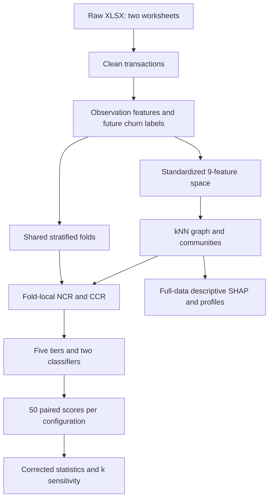

# Quy trình nghiên cứu: từ dữ liệu giao dịch đến kết quả âm về đặc trưng đồ thị

**Tài liệu làm việc của nhóm · Paper #366956 · Cập nhật 13/10/2026**

Tên paper: *When Graph-Derived Neighbourhood Features Do Not Help: A Leakage-Controlled Evaluation of Behavioural-LRFM Churn Prediction in Non-Contractual Retail*. Tài liệu này diễn giải toàn bộ bản thảo `paper/main.tex` và PDF 12 trang, đối chiếu với mã nguồn, kiểm toán và đợt chạy lại ngày 12/10/2026. Đối tượng đọc đã biết Python và học máy cơ bản. Cấu trúc năm chương tham khảo hai ảnh mục lục do người dùng cung cấp; nội dung nghiên cứu được xác định bằng paper và bằng chứng thực thi.

Quy ước nguồn: **[P]** là bản thảo; **[C]** là mã nguồn; **[A]** là kiểm toán; **[R]** là chạy lại thực tế. **Đề xuất** chỉ một việc có thể làm tiếp, chưa phải kết quả đã có. Danh sách nguồn và đường dẫn nằm ở cuối tài liệu. Khi [P] và [C] khác nhau, tài liệu nêu cả hai thay vì âm thầm lựa chọn một phiên bản.

## Lời mở đầu

### 1. Paper nghiên cứu điều gì?

Một cửa hàng trực tuyến thường không biết khách hàng đã rời đi hay chỉ đang chờ lần mua tiếp theo. Khác với dịch vụ thuê bao, khách không phải bấm hủy hợp đồng. Vì vậy nghiên cứu phải quy ước: nếu một khách đã từng mua nhưng không mua trong một cửa sổ tương lai, khách được gán nhãn rời bỏ, gọi là churn. Sau đó mô hình học từ lịch sử trước cửa sổ ấy để xếp hạng nguy cơ không mua trở lại. Nhãn phản ánh sự bất hoạt trong thời gian đã chọn; nó không chứng minh khách vĩnh viễn rời cửa hàng.

Paper đặt câu hỏi cụ thể: **các khách có hành vi mua tương tự có cung cấp thêm thông tin giúp dự báo churn của nhau hay không?** RFM mô tả mỗi người bằng lần mua gần nhất, tần suất và tổng chi tiêu. Pipeline mở rộng lên chín đặc trưng hành vi, nối các khách gần nhau trong không gian đó thành đồ thị, tìm cộng đồng, rồi thêm đặc trưng của nút và tỷ lệ churn của hàng xóm/cộng đồng vào mô hình dự báo. Ý tưởng trực giác là một người có thể giống nhóm đang rời bỏ, dù riêng hồ sơ cá nhân chưa thể hiện hết rủi ro.

Kết quả chính lại là một kết quả âm (negative result): với Online Retail II, hai classifier và các cấu hình đã thử, thêm đặc trưng không tạo cải thiện có ý nghĩa thống kê so với RFM. Kết quả âm vẫn có giá trị vì nó cho biết một hướng xây dựng tưởng hợp lý chưa đem lại lợi ích được xác nhận trong điều kiện kiểm tra rõ ràng. Câu kết luận phù hợp là “chưa phát hiện cải thiện có ý nghĩa trong phạm vi này”, không phải “mọi đồ thị đều vô ích”. [P: Abstract, Introduction, Results, Discussion; A; R]

### 2. Lý do thực tiễn và lý thuyết

Về thực tiễn, cửa hàng có ngân sách giữ chân hữu hạn. Nếu mô hình đơn giản cho thứ hạng nguy cơ tương đương mô hình phức tạp, nhóm vận hành tránh được chi phí dựng đồ thị, bảo trì community và xử lý đặc trưng phụ thuộc nhãn. Ngược lại, nếu đồ thị đem lại cải thiện ổn định, cửa hàng có căn cứ để đầu tư. Nghiên cứu chưa có phản hồi chiến dịch marketing, vì vậy chưa tính được lợi nhuận thực từ việc gửi ưu đãi.

Về lý thuyết, có sự khác nhau giữa **giống nhau** và **tương tác với nhau**. Hai khách có tần suất và chi tiêu gần nhau được nối trong similarity graph, nhưng họ có thể chưa từng liên hệ. Trong đồ thị viễn thông, cạnh có thể là cuộc gọi thực giữa hai thuê bao; đó là nguồn thông tin ngoài hồ sơ cá nhân. Một graph dựng lại từ chính chín đầu vào của classifier có thể chỉ làm trơn thông tin đã có. Đây là lời giải thích được paper thảo luận, chưa phải cơ chế đã được chứng minh bằng thí nghiệm nhân quả.

### 3. Mục tiêu, câu hỏi, đối tượng và phạm vi

Mục tiêu tổng quát là kiểm tra phần giá trị dự báo tăng thêm khi bổ sung các lớp biểu diễn hành vi và đồ thị vào RFM, với kiểm soát nhãn đánh giá và sự biến thiên do chia fold. Mục tiêu cụ thể gồm: xây dựng cohort khách hàng; tạo nhãn theo thời gian; dựng năm tier đặc trưng; đánh giá hai classifier trên cùng partitions; kiểm tra độ nhạy theo số hàng xóm; đối chiếu SHAP với so sánh hiệu năng; và lưu bằng chứng để người khác có thể chạy lại.

Các câu hỏi là: thêm L/hành vi, segment/community và graph block có giúp hơn RFM không; kết luận đổi theo partition/k không; SHAP cao có đồng nghĩa tăng chất lượng dự báo không? Đây là cách tổ chức lại paper để thảo luận, không phải giả thuyết đăng ký trước.

Đối tượng phân tích là khách đã có giao dịch hợp lệ trong cửa sổ quan sát tại một nhà bán lẻ trực tuyến của Anh. Đơn vị dữ liệu gốc là dòng hàng trong hóa đơn; đơn vị đưa vào classifier là khách hàng. Phạm vi kết luận gồm một dataset, một quy ước churn theo cửa sổ tương lai, một họ graph kNN trên Behavioural-LRFM, hai classifier trong repeated CV và bốn mức graph degree. Không mở rộng trực tiếp thành kết luận cho thị trường Việt Nam, khách thuê bao hay mọi retailer.

### 4. Phương pháp và đóng góp

Đây là nghiên cứu định lượng thực nghiệm trên dữ liệu giao dịch thứ cấp. Nó dùng feature engineering, clustering/community detection, supervised classification, repeated cross-validation và kiểm định hiệu số ghép cặp. Không tuyển người trả lời, không dùng bảng hỏi, thang Likert, EFA, CFA hay SEM. “Chọn mẫu” trong ngữ cảnh này là xác định cohort bằng quy tắc làm sạch và thời gian, không phải lấy mẫu người tham gia khảo sát.

Đóng góp tăng dần nằm ở giao thức đánh giá và sự minh bạch của kết quả âm. RFM, kNN, Louvain, Leiden, LightGBM, logistic regression và SHAP đều là công cụ đã có. Tỷ lệ churn hàng xóm cũng đã xuất hiện trong các ngữ cảnh khác. Paper nối các công cụ đó trong bài toán retail similarity graph và kiểm tra bằng nhãn fold-local cùng repeated CV. Không có bằng chứng đủ để gọi đây là thuật toán đồ thị mới, nghiên cứu đầu tiên tuyệt đối hay một cải thiện dự báo đã được xác nhận. Literature search của paper là có mục tiêu, không phải systematic review. [P: Related Work, Threats to Validity]

### 5. Tình trạng thực tế tại ngày 13/10/2026

Nhóm đã có dữ liệu raw, source Python, paper TeX/PDF, bảng kết quả theo fold, summary kiểm định, SHAP, hồ sơ cộng đồng, log và notebook tái lập. Audit ngày 12/10 ban đầu kiểm lại dữ liệu và phép tính trên artifact; sau đó một đợt riêng đã fit lại 10 công việc từ raw bằng môi trường ghim. Vì vậy ghi chú cũ “chưa full model rerun” đã được cập nhật bởi [R], còn phát hiện lệch mô tả phương pháp vẫn còn nguyên.

Mười công việc đều exit 0 trên Windows CPU, tổng thời gian khoảng **17 phút 42 giây**. Lượt repeated CV đầu dùng đặc trưng trong RAM lệch nhẹ một số số; lượt k10 đọc cache vừa tạo mới khớp byte fold scores và summary main archived. Không gọi tất cả đường chạy là giống tuyệt đối. Paper #366956 đã được xác minh Accepted trong hồ sơ kiểm tra; trạng thái này không tự chứng minh đã đăng ký, trả phí, hoàn thành camera-ready hoặc thống nhất người trình bày.

Việc tiếp theo có cơ sở nhất là thống nhất mô tả cửa sổ/L/NCR với code, thu hẹp claim SHAP và “only significant”, làm rõ transductive preprocessing và provenance baseline. Nếu sửa cửa sổ hoặc muốn kết luận riêng về NCR, phải tạo nhánh thí nghiệm mới và fit lại. Chưa fit mô hình với cửa sổ ngày đã sửa; notebook Colab đã được kiểm cấu trúc và helper nhưng chưa chạy toàn bộ trên Colab. [A; R]

## Chương 1. Cơ sở lý thuyết, nghiên cứu liên quan và khoảng trống

### 1.1. RFM, LRFM và hành vi mua

RFM là cách nén lịch sử giao dịch thành ba số. Recency $R$ đo số ngày từ lần mua gần nhất tới mốc phân tích. Frequency $F$ đếm số hóa đơn khác nhau; một hóa đơn có mười dòng sản phẩm vẫn là một lần mua. Monetary $M$ cộng giá trị dòng hàng hợp lệ. Người có $R$ lớn đã lâu không mua; người có $F$ lớn mua nhiều lần; người có $M$ lớn tạo nhiều doanh thu trong cửa sổ. Những ý nghĩa này giúp đọc dữ liệu, nhưng dấu tác động thực tế vẫn phải được mô hình và dữ liệu kiểm tra.

LRFM thêm $L$. Cần chú ý hai định nghĩa đang tồn tại: paper viết khoảng ngày từ lần mua đầu tới lần mua cuối; code tính từ lần mua đầu tới ngày phân tích. Một khách lần đầu mua cách mốc 400 ngày, lần cuối cách mốc 150 ngày sẽ có $L$ trong code khoảng 400, còn định nghĩa first-to-last khoảng 250. Chênh lệch gắn với recency, nên không coi đây là thay đổi tên gọi vô hại. Tài liệu quy trình dùng định nghĩa thực thi để giải thích kết quả hiện có.

Behavioural-LRFM bổ sung giá trị trung bình đơn hàng, kích thước giỏ, độ đa dạng sản phẩm, tỷ lệ hủy và khoảng cách giữa hai lần mua. Mục đích là mô tả cách mua ngoài ba tổng lượng RFM. Tuy vậy nhiều biến có quan hệ với nhau: AOV được tính từ $M/F$; độ đa dạng có thể tăng theo số lần mua. Có nhiều cột hơn không đảm bảo có nhiều thông tin độc lập hơn.

### 1.2. Phân đoạn và dự báo là hai nhiệm vụ khác nhau

Phân đoạn khách hàng (segmentation) tìm nhóm có đặc điểm tương đồng khi chưa cần nhãn churn. Dự báo churn dùng nhãn để học xác suất hoặc điểm nguy cơ cho khách chưa biết kết quả. Một partition có modularity cao có thể hữu ích để mô tả cộng đồng nhưng không tăng ROC-AUC. Ngược lại, classifier dự báo tốt không tự tạo các segment dễ dùng cho chiến dịch. Quy trình phải xác định đang đánh giá nhiệm vụ nào trước khi chọn metric.

Nghiên cứu Corrêa Vianna Filho và cộng sự là điểm xuất phát về segmentation từ góc nhìn graph và maximum k-cut. Paper hiện tại chuyển phạm vi sang supervised churn trên không gian hành vi liên tục. Vì thế không tính phần trăm “cải thiện clustering” bằng silhouette ở hai không gian khác nhau. Silhouette đo sự gắn kết/tách biệt theo khoảng cách của chính không gian được dùng; đổi từ điểm RFM rời rạc ba chiều sang chín biến liên tục đã đổi đối tượng đo. [P: Related Work; Results 8.5]

### 1.3. Đồ thị tương đồng và cộng đồng

Mỗi khách là một nút. Sau chuẩn hóa chín biến, khoảng cách Euclidean xác định khách nào gần nhau. Danh sách $k$ hàng xóm của A có thể chứa B, trong khi danh sách của B không chứa A. Danh sách này có hướng theo cách chọn. Graph NetworkX sau đó nhận cạnh nếu một trong hai phía chọn nhau, tạo graph union vô hướng. Do vậy “k10” không có nghĩa mọi nút trong graph cuối có degree đúng 10.

Louvain tìm partition có modularity cao theo trọng số cạnh. Leiden cải tiến việc tạo cộng đồng kết nối tốt. Hai thuật toán cho phép mô tả cấu trúc mà không dùng churn labels. Trong thực nghiệm chính, Louvain được dùng để tạo dummies và community churn rate. Leiden đã được tính partition nhưng chưa có một so sánh prediction repeated CV với các kiểm soát tương đương. Không biến việc “đã chạy Leiden” thành bằng chứng “kết luận dự báo bền với mọi detector”.

### 1.4. Target leakage và thông tin được phép dùng

Rò rỉ nhãn (target leakage) xảy ra khi thông tin về kết quả cần dự báo đi vào đầu vào đánh giá. Với NCR, vấn đề dễ thấy: nếu tính tỷ lệ churn từ toàn bộ nhãn trước khi chia fold, nhãn của khách validation sẽ ảnh hưởng đặc trưng của các khách hàng xóm. CCR toàn bộ cộng đồng cũng có vấn đề tương tự. Điểm validation khi ấy không còn đại diện cho dự báo với nhãn chưa biết.

Kiểm soát hiện có chỉ dùng nhãn training để tính NCR/CCR cho cả training và validation của fold ấy. Điều này bảo vệ khỏi validation labels trong hai aggregate. Tuy nhiên preprocessing của graph dùng covariates toàn bộ cohort; đó là đánh giá chuyển dẫn (transductive). Classifier scaler lại fit trong fold. Hai mức cần được mô tả riêng. Không thấy validation labels vào CV aggregates không đồng nghĩa toàn bộ pipeline đã là đánh giá quy nạp (inductive) cho khách hoàn toàn mới.

### 1.5. Ba mạch nghiên cứu liên quan

Mạch biểu diễn khách hàng gồm nghiên cứu RFM retail của Chen và cộng sự, extended RFM của Ho và cộng sự, cùng RFM biến thiên theo thời gian của Mena và cộng sự. Chúng giải thích vì sao cần cân nhắc thêm chiều quan hệ, hành vi hoặc thời gian. Tài liệu này dùng chúng theo vai trò được paper nêu, không khẳng định đã đọc toàn văn từng nghiên cứu hay kiểm lại mọi kết quả của chúng.

Mạch cấu trúc gồm graph segmentation, modularity, Louvain, Leiden và dự báo churn trên mạng tương tác. Kostić và cộng sự dùng mạng viễn thông; Lee và Woo dùng dynamic social graph. Chúng cung cấp đối chiếu về **ý nghĩa cạnh**, không phải baseline cùng dataset để so số AUC trực tiếp. Mạch đánh giá gồm Dietterich, Nadeau–Bengio, Bouckaert–Frank và Demšar, làm rõ vì sao điểm của các fold dùng training data chồng lấn không phải quan sát độc lập.

LightGBM, XGBoost và SHAP là công cụ thực nghiệm/giải thích. Trong repeated CV chính chỉ LightGBM và logistic regression được dùng; Decision Tree, Random Forest và XGBoost xuất hiện trong pipeline single-seed rộng hơn. Nêu đúng vai trò giúp nhóm tránh kể tất cả model như đã được kiểm định theo cùng giao thức.

### 1.6. Khoảng trống được kiểm tra

Khoảng trống thực hành mà paper trực tiếp xử lý là đánh giá một lợi ích rất nhỏ bằng một partition rồi xem đó là tiến bộ của feature engineering. Pipeline single-seed từng cho graph tăng khoảng 0,0033 AUC. Câu hỏi là chênh đó còn tồn tại khi nhãn aggregate được kiểm soát và partition được lặp hay không. Đây là khoảng trống có phép thử thực nghiệm cụ thể.

Khoảng trống mở tiếp theo là graph retail có nguồn tín hiệu ngoài bảng hành vi, như tương tác giới thiệu hoặc quan hệ hộ gia đình, và cách đánh giá triển khai theo thời gian. Paper chưa chứng minh các graph ấy tốt hơn. Phần “nghiên cứu trong nước” của ảnh mục lục không được lấp bằng tên bài giả; bibliography hiện có không cung cấp một tổng quan nội địa có hệ thống. Nếu nhóm cần chương literature Việt Nam, phải tìm và kiểm chứng nguồn riêng, ghi rõ tiêu chí tìm kiếm.

**Điểm kiểm tra cuối chương:** người đọc phân biệt được segmentation với prediction; similarity edge với interaction edge; label leakage với transductive covariates; và đóng góp giao thức với thuật toán mới. Câu thảo luận: nếu graph được dựng từ chính đầu vào classifier, nó có thể đưa vào loại thông tin mới nào, và thí nghiệm nào đủ để kiểm câu trả lời?

## Chương 2. Mô hình khái niệm và giả thuyết có thể kiểm tra

### 2.1. Mô hình khái niệm

Luồng lập luận gồm lịch sử mua trước mốc phân tích → biểu diễn cá nhân → nhóm tương đồng → đặc trưng đồ thị → dự báo bất hoạt tương lai. Biến đầu ra là nhãn churn, biến đầu vào là các cột của từng tier. Louvain/KMeans tạo categorical identifiers, không phải biến tiềm ẩn tâm lý. “Cộng đồng” ở đây là partition thuật toán, không tự chứng minh có một cộng đồng xã hội hay quan hệ ảnh hưởng.

Nếu khách tương tự có kết quả tương tự, tỷ lệ churn training lân cận có thể giúp dự báo. Nhưng RFM có thể đã biểu diễn thông tin đó. Cần kiểm trên validation, không chỉ correlation hoặc SHAP.

### 2.2. Tái dựng giả thuyết vận hành

Bảng dưới là **tái dựng vận hành cho tài liệu học nhóm**, không phải giả thuyết đăng ký trước hay hệ phương trình SEM của paper. Với một classifier cố định, định nghĩa $d_f$ là AUC cấu hình mở rộng trừ AUC baseline ở cùng fold. Giá trị trung bình dương có thể gợi lợi ích; cần kiểm định và xem độ lớn hiệu ứng trước khi kết luận.

| Câu hỏi | Đối chiếu thực nghiệm | Bằng chứng cần đọc | Trạng thái |
|---|---|---|---|
| Thêm L có lợi? | LRFM − RFM | Summary paired folds | Đã kiểm tra |
| Thêm hành vi có lợi? | B-LRFM − RFM | AUC và PR-AUC | Đã kiểm tra |
| Thêm chỉ báo nhóm có lợi? | Seg so với tier trước | Hiệu số cùng folds | Có dữ liệu để phân tích |
| Graph block có lợi? | Graph so với RFM/Seg | Main và k-sweep | Đã kiểm ở mức block |
| Riêng NCR có lợi? | Full so với full bỏ NCR | Repeated ablation riêng | Chưa làm |

Các tier-vs-RFM đã được summary script kiểm định trực tiếp. So với tier liền trước cũng có thể tính từ cùng fold scores, nhưng cần ghi đó là phân tích bổ sung và giữ phạm vi phép thử. Graph so với Seg thay đổi sáu biến cùng lúc: bốn static graph features, NCR và CCR. Vì vậy nó không cô lập NCR hoặc CCR.

### 2.3. Tiêu chí đánh giá giả thuyết

Nếu chênh AUC nhỏ, đổi dấu giữa các lần chia hoặc không đạt kiểm định đã chọn, nhóm báo cáo chưa phát hiện cải thiện. $p$ lớn không phải xác suất giả thuyết null đúng và cũng không chứng minh effect bằng 0. Muốn kết luận tương đương cần biên hiệu ứng có ý nghĩa thực tiễn và equivalence test được xác định phù hợp; thực nghiệm hiện chưa có điều đó.

Tương tự, SHAP rank cao không phải tiêu chí chấp nhận giả thuyết lợi ích tăng thêm. SHAP trả lời một fitted model đã dùng các biến như thế nào. Ablation có kiểm soát trả lời bỏ biến thì chất lượng ngoài mẫu đổi bao nhiêu. Kết quả giữa hai câu hỏi có thể khác mà không mâu thuẫn.

**Điểm kiểm tra cuối chương:** mỗi câu hỏi phải gắn được với một cặp cấu hình, một metric, cùng fold IDs và một phạm vi kết luận. Câu thảo luận: nếu đổi cả classifier lẫn feature set và AUC tăng, nhóm cần thêm cặp so nào để biết phần tăng đến từ đâu?

## Chương 3. Thiết kế nghiên cứu và quy trình thực hiện

### 3.1. Quy trình tổng thể theo thứ tự chạy

Bảng recipe ghi đầu vào, thao tác và đầu ra theo [P: Sections 3–7] và [C: `build_features`, graph construction, `fold_features`, evaluation loop].

| Stage | Input | Operation + tham số chính | Output |
|---|---|---|---|
| 1. Nhập dữ liệu | Hai worksheet XLSX | Đọc, ghép, chuẩn tên cột | Transaction log |
| 2. Làm sạch | Log và ID/date | Lọc mua hợp lệ, deduplicate | Purchase/cancellation tables |
| 3. Chia thời gian | InvoiceDate | Áp dụng timestamps hiện hữu | Observation/prediction |
| 4. Tổng hợp | Khách trong observation | Tính chín biến và nhãn | Cohort 5.038 khách |
| 5. Dựng graph | Chín biến chuẩn hóa | Euclidean kNN; $w=1/(1+d)$ | Graph + outgoing lists |
| 6. Phân nhóm | Graph và features | KMeans5, Louvain; Leiden mô tả | Dummies + communities |
| 7. Tạo matrix mỗi fold | Training IDs/labels | NCR/CCR training-only | Năm tier |
| 8. Fit và đánh giá | Tier + shared folds | Hai classifier; 10×5 folds | 500 score rows |
| 9. Kiểm định | Paired fold differences | Nadeau–Bengio; bootstrap mô tả | Summary và phạm vi kết luận |
| 10. Độ nhạy/mô tả | k5/10/15/20, full fit | Sweep; SHAP; profiles | Robustness + exploratory outputs |



Nhánh mô tả cuối cùng phải được đọc riêng với nhánh validation. Nó dùng full fit để diễn giải model và hồ sơ nhóm, không cung cấp một held-out evaluation mới.

### 3.2. Nhập và kiểm tra dữ liệu gốc

Online Retail II có hai worksheet, lần lượt 525.461 và 541.910 dòng, tổng 1.067.371. Số khoảng 541 nghìn thường nhắc tới chỉ một worksheet. Code đọc tất cả sheet rồi ghép; nhóm cần ghi số từng sheet để phát hiện trường hợp chỉ đọc mặc định sheet đầu. Trước khi fit, kiểm filename, dung lượng và hash của raw giúp biết đang dùng đúng dữ liệu, thay vì chỉ dựa vào tên “online_retail”.

Raw local đã được đối chiếu với bản tải trực tiếp từ UCI trong [R], cùng SHA256. Hash là dấu nhận diện file, không phải bằng chứng chất lượng mọi dòng. Nhóm vẫn phải kiểm kiểu ngày, customer ID, quantity, price và invoice. Dữ liệu thiếu CustomerID không thể tổng hợp thành hồ sơ khách trong pipeline này nên được bỏ. Việc bỏ ID thiếu làm giới hạn cohort; không suy ra mẫu đại diện cho toàn bộ khách retailer.

Đầu ra cần có một báo cáo tổng hợp counts và fingerprint, không đưa bản ghi cá nhân vào tài liệu trao đổi. Điểm kiểm tra là hai sheets đã được đọc, ngày parse thành datetime, số raw đúng và schema có các cột cần dùng. Nếu counts khác, dừng trước feature engineering và tìm nguyên nhân ở file/sheets/parse.

### 3.3. Làm sạch giao dịch và tách cancellation

Invoice bắt đầu bằng “C” được nhận diện là cancellation. Code giữ riêng cancellation records để tính tỷ lệ hủy, còn purchase table lấy dòng không hủy, Quantity > 0 và Price > 0. Sau đó bỏ duplicate rows và tính `TotalPrice = Quantity * Price`. Vì một hóa đơn có nhiều sản phẩm, không bỏ duplicate chỉ theo invoice ID. Dòng hàng hợp lệ mới được cộng vào $M$.

Cancellation không được cộng như doanh thu dương. Tỷ lệ hủy sử dụng số invoice hủy trong cửa sổ observation, không dùng cancellation phát sinh sau mốc phân tích. Đây là một kiểm soát đã có trong code v2, sửa vấn đề phiên bản cũ từng nhìn toàn bộ log. Điểm kiểm tra là mọi đặc trưng giao dịch dùng đúng cửa sổ đã chốt; việc lọc ngày phải áp dụng cả purchase lẫn cancellation.

### 3.4. Cửa sổ thời gian và cohort

Paper mô tả observation 01/12/2009–30/06/2011 và prediction 01/07/2011–30/09/2011. Code hiện đặt `OBS_END = Timestamp("2011-06-30")`, `PRED_END = Timestamp("2011-09-30")`; timestamp không có giờ là 00:00. Purchase observation thỏa `date <= OBS_END`; prediction thỏa `date > OBS_END` và `date <= PRED_END`. Vì vậy giao dịch ban ngày 30/6 được đưa vào prediction, giao dịch ban ngày 30/9 bị loại khỏi prediction. [C; A]

Cách cắt này tạo 556.212 observation rows và 5.038 khách. Nếu thay bằng ngày trọn vẹn, audit tính được 557.398 observation rows, 5.041 khách; 28 labels đổi trong phần khách chung. Đây mới là kiểm đếm, không có bộ model đã fit cho cửa sổ sửa. Không ghép counts mới vào bảng AUC cũ rồi gọi đó là một thực nghiệm hoàn chỉnh.

Khi tái lập archived result, giữ nguyên timestamps và ghi rõ. Khi làm một phiên bản sửa, có thể dùng half-open windows như minh họa dưới; **đây là đề xuất, chưa phải source hiện tại**. Q3 trọn vẹn có 92 ngày, vì vậy không gọi chính xác nó là 90 ngày.

```python
# Proposed whole-day windows; not the current archived implementation.
obs = purchases[(purchases.InvoiceDate >= "2009-12-01") &
                (purchases.InvoiceDate < "2011-07-01")]
pred = purchases[(purchases.InvoiceDate >= "2011-07-01") &
                 (purchases.InvoiceDate < "2011-10-01")]
```

Cohort chỉ gồm người đã có mua hợp lệ trong observation. Customer mới chỉ xuất hiện trong prediction không được đưa vào đánh giá này. Nhãn $y_i=1$ nếu khách cohort không có purchase hợp lệ trong prediction; $y_i=0$ nếu có. Với implementation hiện có, 3.285/5.038 khách là churn, khoảng 65,2044%. Churn là lớp đa số, không phải positive hiếm.

### 3.5. Tạo chín đặc trưng

Đặt $a$ là ngày phân tích, $t_i^{first}$/$t_i^{last}$ là ngày mua đầu/cuối observation, $q_{ir}$ là số lượng và $p_{ir}$ là đơn giá dòng hàng. Các công thức dưới diễn giải code [C], không phải hệ phương trình được paper đánh số. Phép lấy `.dt.days` trong code trả số ngày nguyên; nhóm cần nhớ dữ liệu có giờ.

$$
R_i = a-t_i^{last},\qquad L_i = a-t_i^{first}
$$

$F_i$ đếm invoice khác nhau. $M_i=\sum_r q_{ir}p_{ir}$ trên purchase observation, và $AOV_i=M_i/F_i$. BasketSize là trung bình số StockCode khác nhau trong mỗi invoice; không phải tổng quantity trong giỏ. ProductDiversity là số StockCode khác nhau trên toàn observation của khách. Hai biến basket/diversity không thể dùng thay nhau.

CancellationRate là số invoice hủy chia cho số invoice hủy cộng $F_i$; khách không có hủy nhận 0. InterpurchaseTime lấy ngày đầu ghi cho mỗi invoice, sắp xếp theo thời gian, lấy trung bình các khoảng giữa invoice liên tiếp. Khách chỉ có một invoice chưa có interval nên nhận median IPT của cohort. Imputation này hiện được tính trước CV từ toàn bộ covariates; nếu muốn inductive protocol phải fit median trong training và áp dụng cho validation.

Ví dụ giả định cho học: một khách có ba invoice, tổng 300 đơn vị tiền, mỗi giỏ lần lượt có 2, 4, 3 loại hàng, toàn lịch sử có 6 loại khác nhau. Khi ấy F=3, M=300, AOV=100, BasketSize=3, ProductDiversity=6. Nếu có một invoice hủy trong observation, cancellation rate bằng 1/(1+3)=0,25. Đây là ví dụ minh họa, không phải một customer record trong dataset.

Đầu ra là một dòng mỗi CustomerID với chín feature và một label. Kiểm tra F dương, M dương với cohort purchase, cancellation rate trong [0,1], không duplicate IDs, không NaN chưa xử lý. Giữ riêng label khỏi danh sách chín cột dùng dựng graph. Chỉ cần vô tình đưa `Churn` vào distance là đổi bài toán và làm hỏng kiểm soát.

### 3.6. Chuẩn hóa, kNN và graph weights

StandardScaler đưa từng cột về thang chuẩn hóa trước khi đo Euclidean distance. Nếu không làm, monetary có thể lấn át cột nhỏ do khác đơn vị. Code hiện fit graph scaler trên toàn cohort; đây là thông tin covariates toàn bộ, cần giữ nhãn transductive trong mô tả. Không đồng nhất scaler này với scaler trong classifier pipeline.

NearestNeighbors lấy k+1 điểm để bỏ vị trí đầu thường là chính nút; artifact hiện tại không có self-neighbour. Với mỗi outgoing neighbour j, code thêm cạnh vào graph vô hướng nếu chưa có, trọng số như paper:

$$
w(i,j)=\frac{1}{1+d(i,j)}
$$

Đây là công thức graph trong [P: Section 5]. Hai điểm gần có cạnh nặng hơn. Ở k10, graph có 5.038 nút, 33.426 cạnh. Degree vô hướng thực tế 10–25, trung bình khoảng 13,27 theo audit, vì union nhận cả lựa chọn đi vào. NCR lại dùng đúng danh sách outgoing kNN, không dùng mọi graph neighbour vô hướng. Tài liệu công thức và code phải nói rõ tập nào.

### 3.7. Clustering, communities và static graph features

KMeans dùng 5 clusters, random_state=42, n_init=10 trong pipeline dự báo. Louvain dùng graph weights và seed=42. Partition k10 archived có 20 cộng đồng, modularity 0,8385; Leiden trong pipeline full có 20, modularity 0,8323. Modularity cao mô tả graph được xây, không chứng minh prediction tốt hoặc có contagion thật. KNN vốn tạo nhiều quan hệ cục bộ nên cấu trúc graph góp phần vào giá trị đó.

Bốn static graph features là Degree, WeightedDeg, PageRank và ClustCoeff. Degree đếm số cạnh; WeightedDeg cộng trọng số; PageRank đo vị trí kết nối theo thuật toán; ClustCoeff mô tả mức các hàng xóm nối với nhau theo cách tính weighted clustering của code. Các biến này không cần churn labels.

Segment IDs được one-hot để model không đọc community 19 như “lớn hơn” community 2. Với drop_first, KMeans5 tạo 4 dummies, Louvain20 tạo 19, tổng 23. Số dummies thay đổi khi k làm số cộng đồng thay đổi; con số 38 features chỉ là full matrix tại k10. Repeated CV chính không thêm Leiden dummies.

### 3.8. Tạo NCR/CCR bên trong từng fold

Gọi $T$ là tập chỉ số dòng/node trong training, $N_i$ là outgoing kNN list và $C_i$ là tập khách thuộc Louvain community của i. Code dùng vị trí dòng từ 0 đến n−1, có mapping sang CustomerID; không dùng trực tiếp mã CustomerID làm index của graph. Định nghĩa trung bình trên phần giao với training:

$$
NCR_i(T)=\frac{\sum_{j\in N_i\cap T} y_j}{|N_i\cap T|},\qquad CCR_i(T)=\frac{\sum_{j\in C_i\cap T} y_j}{|C_i\cap T|}
$$

Công thức này tái dựng `fold_features` [C] và làm rõ tập hàng xóm; paper diễn đạt công thức bằng lời ở Section 6. Khi mẫu số bằng 0, code dùng churn base rate của training fold. Validation labels không tham gia tổng. Với training row, CCR bao gồm label của chính row trong community mean; vấn đề target encoding train/validation lệch vẫn cần kiểm bằng leave-one-out hoặc inner cross-fitting. Đó là hướng cải tiến được audit chỉ ra, chưa có thí nghiệm riêng.

Ví dụ giả định: i có bốn outgoing neighbours, hai thuộc training với labels 1 và 0, hai thuộc validation. NCR dùng hai người training nên bằng 0,5; không nhìn hai labels validation. Ví dụ này minh họa quy tắc, dù cấu hình main dùng k10. Điểm kiểm tra là truyền đúng `train_idx`, không gọi hàm aggregate một lần ở ngoài CV rồi tái dùng trong mọi fold.

### 3.9. Năm tier và hai classifier

| Tier | Nội dung ở k10 | Số biến | Vai trò |
|---|---|---:|---|
| RFM | R, F, M | 3 | Baseline chính |
| LRFM | RFM + L thực thi | 4 | Kiểm chiều quan hệ |
| B-LRFM | Chín biến hành vi | 9 | Kiểm biểu diễn mở rộng |
| B-LRFM+Seg | Chín biến + 23 dummies | 32 | Thêm segment/community |
| Graph-Enhanced | Seg + 4 static + NCR/CCR | 38 | Thêm graph block |

LightGBM main dùng 300 estimators, learning_rate=0,05, max_depth=6, random_state=42, is_unbalance=True. Logistic regression dùng max_iter=1000, class_weight="balanced", random_state=42; paper mô tả regularization L2. Các tham số này là cấu hình thực nghiệm hiện có, không phải kết quả một hyperparameter search tối ưu đã được chứng minh. Churn là majority nên class weighting cần được đọc như lựa chọn model, không phải bằng chứng đã giải một positive class hiếm.

Mỗi classifier được đặt sau StandardScaler trong sklearn Pipeline. Scaler của bước này fit chỉ training, rồi transform validation. Mỗi fit clone model prototype để tránh dùng fitted state từ fold trước. Quy trình này là kiểm soát preprocessing của classifier, trong khi graph/KMeans/imputation vẫn dùng toàn cohort covariates.

### 3.10. Repeated CV, pairing và metrics

StratifiedKFold chia 5 folds với shuffle; mặc định repeated script dùng seeds 1000 đến 1009. Mỗi repeat tạo một partition chung cho mọi tier và model. Với khoảng 5.038 khách, mỗi lượt có khoảng 80% training và 20% validation. Một cấu hình nhận 50 fold scores; năm tier × hai models tạo 500 rows trong một bộ main. Không gọi 500 rows là 500 khách hoặc 500 independent experiments.

ROC-AUC đo khả năng xếp một positive cao hơn một negative. AUC khoảng 0,81 không có nghĩa accuracy 81%, không phải xác suất cứu khách và không phải tỷ lệ doanh thu được giữ. PR-AUC trong code là `average_precision_score`; ghi rõ implementation này vì “diện tích PR” có nhiều cách tính. Positive prevalence khoảng 0,652 làm baseline precision cao hơn ngữ cảnh positive hiếm, nên phải đọc PR-AUC cạnh ROC-AUC.

Single-seed pipeline còn báo F1 và recall khi threshold=0,5. Đây là metrics theo ngưỡng, khác ranking metrics; threshold chưa được tối ưu theo chi phí chiến dịch. Repeated script chính ghi AUC và PR_AUC, vì vậy không trình bày F1/recall single seed như đã có uncertainty 50 folds tương đương.

### 3.11. Kiểm định và khoảng tin cậy

Với $d_f$ là hiệu số score hai cấu hình ở fold f, tính mean difference trước khi diễn giải. Paper dùng corrected resampled t-test:

$$
t=\frac{\bar d}{\sqrt{\hat\sigma^2(1/n+n_2/n_1)}},\qquad n=50,\quad n_2/n_1=1/4
$$

Đây là phương trình (1) của paper; $\hat\sigma^2$ là sample variance của paired differences, $n_2/n_1$ là tỷ lệ validation/training của five-fold. Code lấy p hai phía với degrees of freedom 49. Hệ số hiệu chỉnh làm rõ rằng 50 folds chia sẻ training data; naive paired t-test giả định độc lập sẽ đánh giá uncertainty quá thấp. Summary còn lưu naive t và Wilcoxon để đối chiếu, nhưng paper chọn p Nadeau–Bengio làm cơ sở significance.

Bootstrap lấy 10.000 mẫu từ 50 differences để mô tả khoảng của effect magnitude. Paper cảnh báo bootstrap này không xử lý đầy đủ phụ thuộc fold nên không dùng CI hẹp làm lý do thay pNB. P<0,05 chỉ là tiêu chí trong các phép thử đã báo. pNB hiệu chỉnh sự phụ thuộc do overlap giữa folds, chưa hiệu chỉnh theo họ nhiều phép so sánh; điều này áp dụng cả main/Table 2 và các cặp exploratory bổ sung. Nhóm cần nêu phạm vi và tránh đi săn cặp p nhỏ rồi kể như giả thuyết gốc.

### 3.12. Sweep, SHAP và các checkpoint

K-sweep dựng lại graph, Louvain và fold-local features tại k=5,10,15,20 rồi chạy cùng repeated protocol. Đây là sensitivity trong một họ graph, không thay cả distance metric hoặc nguồn cạnh. Source điều khiển bằng `LRFM_KNN_K` và `LRFM_OUT_SUFFIX`; không có `src/knn_sweep.py` như comment cũ nhắc. Output suffix giữ mỗi cấu hình riêng, giúp đối chiếu không ghi đè kết quả main.

Full-data fitted LightGBM phục vụ SHAP/profile được tạo sau CV. NCR/CCR ở nhánh này dùng full labels, model fit toàn cohort và giải thích tối đa 800 training samples. Đầu ra có thể dùng mô tả fitted model nếu ghi rõ in-sample/exploratory; nó không phải SHAP của model held-out. Auxiliary improvement script có một số variants tạo aggregates toàn cục, nên không dùng chúng thay main controlled evidence.

Checkpoint chuyển sang kết quả là: có đủ folds, unique FoldId/Tier/Model, partitions ghép cặp, summary tái tính đúng, logs exit status, fingerprints và graph settings. Chỉ nhìn “Done” trên màn hình chưa kiểm được nguồn dữ liệu, leakage scope hoặc cách tính p. Câu thảo luận cuối chương: nhóm sẽ đánh giá khách mới trong triển khai như thế nào nếu graph hiện được dựng bằng toàn bộ covariates của cohort đánh giá?

## Chương 4. Kết quả và thảo luận

### 4.1. Từ single seed đến repeated CV

Bảng dưới giữ nguyên số Table 1 của paper. “Single seed” là một lượt five-fold với seed42, không phải một train/test split duy nhất. Repeated CV dùng mười lượt partition, mỗi lượt năm folds. pNB đối chiếu với RFM **cùng LightGBM**.

| Tier | AUC single seed | AUC repeated | Δ so với RFM | pNB |
|---|---:|---:|---:|---:|
| RFM | 0,8065 | 0,8066 | — | — |
| LRFM | 0,8071 | 0,8074 | +0,0009 | 0,755 |
| B-LRFM | 0,8067 | 0,8054 | −0,0012 | 0,742 |
| B-LRFM+Seg | 0,8073 | 0,8044 | −0,0022 | 0,561 |
| Graph-Enhanced | 0,8098 | 0,8044 | −0,0021 | 0,590 |

Trình tự nghiên cứu là xây pipeline, quan sát graph tăng +0,0033 trong seed42, rồi kiểm lại bằng partitions lặp. Với repeated CV, dấu graph-vs-RFM chuyển âm. Ngay artifact seed42 cũ, bootstrap interval [−0,0025; +0,0099] đã chứa 0. Kết quả không xác nhận lợi ích tăng thêm ổn định. Cả 16 tier-vs-RFM comparisons của hai metrics và hai classifiers có pNB≥0,05; nhỏ nhất khoảng 0,144. F1=0,8108, recall=0,8009 và PR-AUC=0,8689 của graph single seed không thay thế được kiểm tra này.

Figure 2 biểu diễn mean AUC với band ±1 SD của fold scores, khoảng 0,014. Band là spread giữa folds, không phải CI cho hiệu số hoặc interval dự báo một khách. Không đọc hai band chồng nhau như một phép kiểm định; dùng paired differences và pNB. “Hiệu ứng nhỏ dễ đổi theo partition” là bài học phù hợp hơn khẳng định mọi effect nhỏ đều đúng bằng noise.

### 4.2. Đổi classifier và đổi features

Table 2 của paper có các so sánh sau:

| Cặp pipelines | ΔAUC | Bootstrap CI 95% | pNB |
|---|---:|---|---:|
| LogReg/B-LRFM − LGBM/Graph | +0,0113 | [+0,0096; +0,0130] | 0,001 |
| LogReg/RFM − LGBM/Graph | +0,0099 | [+0,0080; +0,0119] | 0,010 |
| LogReg/RFM − LGBM/RFM | +0,0078 | [+0,0056; +0,0100] | 0,068 |

Hai hàng đầu đạt p<0,05, hàng thứ ba không đạt. Cụm “only significant comparison” trong paper cần thu hẹp/sửa vì ngay bảng này đã có hai hàng significant. Hai hàng đầu đổi đồng thời model và feature tier nên chứng minh khác biệt giữa pipelines, không cô lập graph effect. Không suy ra chỉ từ đó rằng features đã “vắt hết tín hiệu” hay model phức tạp chỉ học variance. Các p exploratory bổ sung trong audit chưa điều chỉnh multiple comparisons.

### 4.3. Độ nhạy theo graph degree

| k | Cạnh | Louvain communities | ΔAUC Graph−RFM | pNB |
|---:|---:|---:|---:|---:|
| 5 | 16.902 | 31 | −0,0006 | 0,880 |
| 10 | 33.426 | 20 | −0,0021 | 0,590 |
| 15 | 50.054 | 16 | +0,0017 | 0,666 |
| 20 | 66.652 | 16 | −0,0027 | 0,500 |

Cả bốn k không phát hiện gain significant. Đây là kiểm tra đã hoàn tất, thay ghi chú tháng 8 còn nói thiếu sweep. K15 có delta dương nhưng p cao, không đủ cơ sở chọn làm “mô hình thắng”. Đổi dấu theo k cũng không tự chứng minh noise; effect thật có thể phụ thuộc hyperparameter. Kết luận giới hạn ở họ graph/distance/weights hiện tại.

### 4.4. SHAP, ablation và segment profiles

Paper báo top mean absolute SHAP: R=1,087; M=0,560; NCR=0,250; IPT=0,224; CCR=0,215. Những số này mô tả model full-data đã fit, không phải mức tăng AUC của từng biến. TreeExplainer trong code dùng output raw mặc định; với LightGBM binary đây là raw margin/log-odds, nên giá trị SHAP không bị chặn trong [0,1] và không phải trực tiếp điểm phần trăm xác suất. Seg và Graph cùng làm tròn 0,8044, nhưng sáu cột thay đổi cùng lúc. Audit tính Graph−Seg khoảng +0,000051, pNB≈0,987; interval có hiệu chỉnh còn chứa gain/loss đáng kể. Do vậy viết “chưa thấy block graph cải thiện”, không viết “bỏ riêng NCR không mất gì”. Chưa có NCR-only repeated ablation.

Silhouette tham chiếu 0,398 của baseline published và lời “we reproduce 0,398” phải tách nhau. Local approximation hiện cho khoảng 0,4771, còn 0,398 trong comparison code là hằng tham chiếu; chưa đủ provenance cho reproduction claim. KMeans≈0,219 và Louvain≈−0,050 không được so thắng/thua với baseline khác không gian. Comparison dùng toàn lịch sử giao dịch, khác cửa sổ cohort churn. Profiles có nhóm 327 khách, churn≈82%, và nhóm 418 khách, churn≈24%. Đó là mô tả cohort, không phải hiệu quả chiến dịch.

### 4.5. Kết quả chạy lại ngày 12/10

Lượt raw/in-memory mới cho Graph AUC≈0,804533, Δ≈−0,002021, p≈0,606129. Lượt k10 đọc cache **vừa xây từ raw** cho AUC≈0,804422, Δ≈−0,002130, p≈0,590480, khớp byte main archived. Bốn bộ sweep khớp archived; single-seed pipeline, comparison, auxiliary, SHAP và profiles cũng khớp byte. Hai seed42 CSV của repeated harness mới khác artifact seed42 cũ, nên không trộn chúng với cột single-seed pipeline.

Nguyên nhân chính xác khác biệt RAM/CSV chưa được cô lập; không quy cho library drift hoặc sửa dữ liệu. Tracked originals không đổi. Paper nói full pipeline dưới mười phút; số đo suite 10 jobs mới là 17 phút 42 giây, phạm vi công việc khác nên cần ghi rõ thay vì coi một mốc là tốc độ bảo đảm. Câu thảo luận: kết quả nào thuộc main controlled CV, kết quả nào thuộc nhánh mô tả và artifact nào đủ hỗ trợ câu kết luận dự định viết?

## Chương 5. Hàm ý, hạn chế và công việc tiếp theo

### 5.1. Hàm ý nghiên cứu và vận hành

Với nghiên cứu, ưu tiên baseline đơn giản, shared partitions và effect sizes trước khi kể sự phức tạp của framework. Với retailer, RFM/logistic regression là lựa chọn tham chiếu hợp lý trong phạm vi thử nghiệm, nhưng chưa có external validation để chốt production. Điểm `churn_probability * M` dùng xếp ưu tiên mô tả; chưa chứa xác suất đáp ứng ưu đãi, margin hay chi phí, nên không gọi là lợi nhuận giữ chân dự kiến đã xác thực.

Với kỹ thuật, cần version source/data/window/cache, giữ per-fold scores và phân biệt graph preprocessing với classifier preprocessing. Với cơ quan quản lý, paper chưa có bằng chứng cho một chính sách cụ thể. Không chuyển mục “giải pháp cơ quan quản lý” của mẫu khảo sát thành kiến nghị pháp lý không được nghiên cứu.

### 5.2. Hạn chế và cách giảm hạn chế

Paper nêu giới hạn dataset/graph/metric/literature/business validation; Country và SpectralClustering chưa thực hiện. Audit bổ sung lệch cửa sổ/L/NCR, transductive covariates, CCR self-label, SHAP in-sample, thiếu ablation và provenance 0,398. Reproduction không giải quyết các điểm này.

**Đề xuất theo thứ tự:** sửa văn bản để phản ánh code và phạm vi; chốt phiên bản cửa sổ trước một rerun mới; thử target encoding cross-fitting cùng NCR/CCR ablations; chạy Louvain/Leiden với protocol tương đương; đánh giá temporal/inductive; thử graph tín hiệu ngoài bảng hành vi và retailer khác; cuối cùng kiểm campaign response. Mỗi bước cần manifest/output riêng, không ghi đè archived evidence. Mốc 0,005 AUC trong discussion chỉ nên đọc như heuristic từ quan sát, chưa có power/equivalence study xác lập detection threshold.

### 5.3. Handoff đề xuất cho thành viên

| Vai trò đề xuất | Việc cụ thể | File bàn giao | Điều kiện hoàn thành |
|---|---|---|---|
| Data reviewer | Chốt windows/L và counts | Decision note | Cùng định nghĩa với source |
| Experiment owner | Ablation và temporal protocol | Manifest/folds/logs | Shared folds, outputs riêng |
| Literature reviewer | Kiểm nguồn graph/novelty | Evidence ledger | Nguồn đọc thật, giới hạn rõ |
| Writing reviewer | Sửa scope/cross-model/SHAP | Claim-to-evidence table | Mọi claim có artifact |

Đây là phân công gợi ý, không phải ghi nhận thành viên mới đã đóng góp. Thảo luận nhóm nên kết thúc bằng một quyết định có bằng chứng: câu nào sửa bằng văn bản, câu nào bắt buộc chạy thí nghiệm, việc nào nằm ngoài mục tiêu bản hiện tại.

## Kết luận

Quy trình đã đi từ log giao dịch tới cohort, chín đặc trưng, graph/community, năm tier, đánh giá ghép cặp lặp và sensitivity theo k. Bằng chứng hiện hỗ trợ một kết quả âm có phạm vi: chưa phát hiện cải thiện có ý nghĩa của các tier mở rộng so với RFM cùng classifier. Bài học về leakage, pairing và phân biệt attribution/contribution hữu ích, nhưng một số diễn giải cần thu hẹp. Có source và rerun thật; vẫn cần quyết định phương pháp trước những claim mới.

## Tài liệu tham khảo và hồ sơ bằng chứng

Danh mục có 17 entries trong bibliography và trang 11–12 PDF; tài liệu kế thừa nguồn của paper, không tuyên bố đọc lại toàn văn từng nguồn. Paper công khai dùng Claude hỗ trợ bản thảo/code/đối chiếu số và tác giả chịu trách nhiệm nội dung. Các nhóm nguồn chính:

- RFM/retail: Chen et al. (2012), Ho et al. (2023), Mena et al. (2023), Online Retail II/UCI (2019).
- Graph/community: Corrêa Vianna Filho et al. (2026), Newman–Girvan (2004), Blondel et al. (2008), Traag et al. (2019).
- Graph churn: Kostić et al. (2020), Lee–Woo (2025).
- Evaluation: Dietterich (1998), Nadeau–Bengio (2003), Bouckaert–Frank (2004), Demšar (2006).
- Tools: Chen–Guestrin/XGBoost (2016), Ke et al./LightGBM (2017), Lundberg–Lee/SHAP (2017).

[P] [Paper TeX](../../paper/main.tex), [PDF](../../paper/main.pdf), [Bibliography](../../paper/refs.bib).

[C] [Pipeline](../../src/run_pipeline_v2.py), [Repeated CV](../../src/significance_test.py); comparison, auxiliary, figure scripts.

[A] [Audit](evidence/experiment-audit-20261012.md). [R] [Rerun report](04-bao-cao-tong-hop.md), [Manifest](evidence/reproduction-manifest.json), [Comparison](evidence/comparison.json).

## Phụ lục A. Checklist tái lập và tiếp nhận công việc

- Ghi commit, Python/dependency versions, raw hash và cửa sổ chính xác.
- Tái lập archived implementation trước; đặt output mới riêng.
- Kiểm hai sheets, customer cohort, labels, chín cột và cache provenance.
- Kiểm outgoing neighbours khác undirected degree; labels không vào graph.
- NCR/CCR dùng training labels; classifier scaler fit training.
- Giữ shared FoldId, đủ 50 scores/configuration, không duplicates.
- Tái tính mean/delta/pNB; ghi bootstrap limitation và multiple-test scope.
- Ghi k, community count, suffix và branch RAM/cache cho từng run.
- Phân loại CV metrics, full-data SHAP, profiles và auxiliary evidence.
- Không gọi notebook Colab đã chạy nếu chỉ compile/validate cells.
- Khi thay windows/features, fit lại và nối claim với output mới.

## Phụ lục B. Chuyển mục lục tham khảo sang nghiên cứu ML

| Mục trong ảnh | Cách áp dụng tại đây |
|---|---|
| Thang đo, bảng hỏi, khảo sát | Định nghĩa features/labels và quy tắc xử lý log |
| Chọn mẫu, mô tả mẫu | Cohort customers và mô tả dữ liệu giao dịch |
| Kiểm định thang đo, EFA/CFA | Kiểm feature construction, tier comparisons, paired CV |
| Giả thuyết và mô hình | Tái dựng câu hỏi vận hành, không dùng SEM |
| Kiến nghị doanh nghiệp/thương mại điện tử | Hàm ý baseline, ưu tiên mô tả; cần business validation |
| Giải pháp cơ quan quản lý | Chưa có bằng chứng nghiên cứu để kiến nghị riêng |

## Thuật ngữ

| English | Tiếng Việt | Ý nghĩa trong quy trình |
|---|---|---|
| Cohort | Tập khách đủ điều kiện | Có mua hợp lệ trong observation |
| Fold-local | Theo từng fold | Chỉ nhãn training cho aggregate |
| Paired comparison | So sánh ghép cặp | Cùng khách validation ở từng FoldId |
| Transductive | Chuyển dẫn | Covariates validation có trong graph preprocessing |
| Ablation | Loại bỏ thành phần | Đổi một block/biến, giữ protocol để đo đóng góp |
| Attribution | Phân bổ đóng góp model | SHAP của fitted model, khác incremental AUC |
